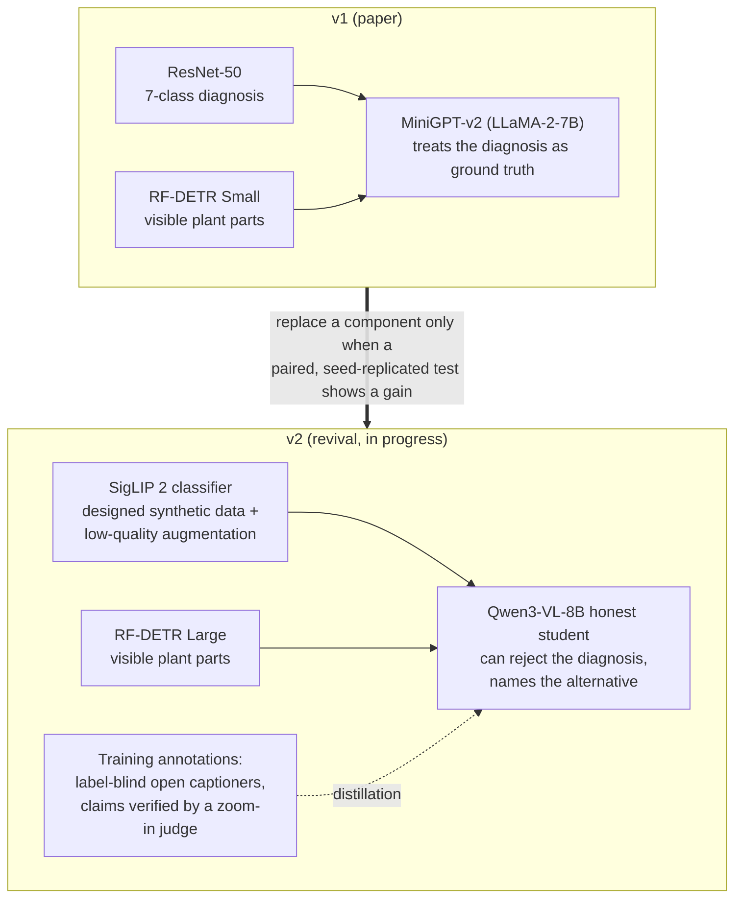

# AGAI: Plant Diagnostic System

An AI system that diagnoses strawberry plant problems from a photo and explains the diagnosis: it classifies the
image into seven conditions (healthy, drought, overwatering, root rot, frost injury, gray mold, white mold), finds
the visible plant parts, and writes a grounded report with treatment advice sourced from university extension
publications.

> Research prototype developed at Middle Tennessee State University. Not a substitute for professional agronomic
> advice.

**[Research paper (v1)](RESEARCH_PAPER.pdf)** · **[Lab notebook](cluster/EXPERIMENT_LOG.md)** ·
**[Roadmap](docs/ROADMAP.md)** · **[v1 setup and demo](docs/V1_SYSTEM.md)**

## Overview

**v1** (the paper) chains a ResNet-50 classifier, an RF-DETR Small plant-part detector and a LoRA-adapted
MiniGPT-v2 explainer behind a Gradio demo.

**The 2026 revival** re-establishes the system on the university's Slurm cluster and re-examines every component
under a stricter protocol: the v1 results are reproduced first, then each component is replaced only where a
leak-free, seed-replicated, paired comparison shows a gain. All annotation and captioning runs on open models locally
(no API spending). The work is organised around four questions:

1. **Benchmark.** Is the evaluation sound? The paper's holdout leaks through near-duplicates and is too small to rank
   models; a grouped split with paired statistics replaces it.
2. **Diagnosis.** How much of the classifier's error is architecture, how much data?
3. **Honesty.** Can the explainer *disagree* with a wrong diagnosis instead of rationalising it?
4. **Faithfulness.** Which open vision-language model describes a photo without inventing symptoms, and can
   invented symptoms be caught automatically?

## Architecture



## Results so far

All numbers on the leak-free split v1 test set (398 photos) unless noted; ± is the standard deviation over seeds.

| Component | v1 | Revival | Details |
|---|---|---|---|
| Benchmark | 70-photo holdout; 14 "clean" images had near-copies in training | split v1, 1,017 / 161 / 398, near-duplicate groups never cross splits; paired McNemar tests; pre-registered analyses | [Benchmark](docs/BENCHMARK.md) |
| Diagnosis accuracy | ResNet-50: 90.2 ± 1.5 % | SigLIP 2: 95.6 ± 1.3 %, EVA-02-L: 95.7 ± 1.1 %; with the data recipe 96.3 ± 0.8 %; ensembles 97.2-97.7 % (≈ label-noise ceiling) | [Classifier](docs/CLASSIFIER.md) |
| Low-detail photos (128 px) | not measured | 83.7 → 92.1 % with train-time phone degradation, clean accuracy unchanged | [Synthetic data](docs/SYNTHETIC_DATA.md) |
| "Roots visible → root rot" shortcut | present (0-1 of 6 healthy dug-up roots called healthy) | removed (5-6 of 6) by designed synthetic counter-examples | [Synthetic data](docs/SYNTHETIC_DATA.md#the-roots-shortcut) |
| Plant-part detection, mAP@50:95 | RF-DETR Small 0.598 | RF-DETR Large 0.631 (+3.8 points over a like-for-like retrained Small, 0.593) | [Detector](docs/DETECTOR.md) |
| Explainer honesty (label-swap test, balanced) | explainer receives the label as ground truth (not testable as built) | 8B student 82.5 % vs its 32B teacher 77.6 % (p = 0.00013); best zero-shot model (Qwen3-VL-235B) 80.7 % | [VLM honesty](docs/VLM_HONESTY.md) |
| Test-time compute instead of training | — | zero-shot VLMs: voting over 20 samples +1-2 points (n.s.), debate and reference images +0, explanation before the answer −5 to −9 points; best zero-shot 76.1 % (GLM-4.6V, vote) vs 96.3 % fine-tuned | [Test-time compute](docs/TEST_TIME_COMPUTE.md) |
| Caption faithfulness (blind human ratings) | — | 4 open captioners: 4.0-10.3 % of claims not in the photo (interim, 615 of 845 claims) | [Captioning](docs/CAPTIONING.md) |
| Hallucination filtering | — | a judge model that re-examines each claim (8B-235B) removes 2.8-3.7 false claims per real claim lost, and a bigger judge is not better; agreement and self-consistency checks 1.3-1.5 | [Captioning](docs/CAPTIONING.md#4-hallucination-filters) |

<picture>
  <source media="(prefers-color-scheme: dark)" srcset="docs/figures/classifier_dark.png">
  
</picture>

**What the evidence says so far.**

- **The data, not the model, is now the bottleneck.** At ~97 % the remaining test errors are mostly label noise or
  ambiguous photos; the next gains come from expert relabeling and new real photos of the weak classes.
- **Explanations need a model that can say "this photo does not show that".** Off-the-shelf VLMs accept a wrong
  label about a quarter of the time; distillation filtered to correct verdicts fixes much of it.
- **Agreement is not truth.** Open captioners share blind spots (normal stem hairs read as mold by three of four
  models), so voting and self-consistency make poor hallucination filters. Asking a judge model to re-examine each
  claim at the place it points to works far better, and an 8B judge is enough; look-alikes of disease signs still
  fool every judge.
- **Inference tricks do not replace training.** Voting over many sampled answers, multi-round debate between models
  and reference images leave zero-shot diagnosis ~20 points below a 10-minute fine-tune, and asking a model to explain
  before answering makes it worse. Sampling is useful for *uncertainty*: vote share and model disagreement flag most
  errors, and when two models disagree the truth is one of their two answers ~70 % of the time.

## Documentation

| Page | Contents |
|---|---|
| [Benchmark](docs/BENCHMARK.md) | split v1, auxiliary test sets, low-quality suite, statistics, known data defects |
| [Classifier](docs/CLASSIFIER.md) | v1 reproduction, zero-shot VLMs, frozen probes, fine-tuned backbones, ensembles, error analysis |
| [Synthetic data](docs/SYNTHETIC_DATA.md) | the lab's GPT images, a shortcut-aware synthetic set, robustness to poor photos |
| [VLM honesty](docs/VLM_HONESTY.md) | annotation schema, label-swap test, filtered distillation, teacher comparison |
| [Captioning](docs/CAPTIONING.md) | two-pass captioning, captioner bake-off, blind human ratings, hallucination filters |
| [Test-time compute](docs/TEST_TIME_COMPUTE.md) | voting over samples, two-answer captions, debate, reference images, answer format |
| [Detector](docs/DETECTOR.md) | RF-DETR Small / Medium / Large |
| [Compute](docs/COMPUTE.md) | cluster, environments, multi-node serving of 100B+ models, reproducing a result |
| [Roadmap](docs/ROADMAP.md) | what is done, running and next; decisions; paper outline |
| [v1 system](docs/V1_SYSTEM.md) | the paper's system: setup, demo, training, knowledge graph |
| [`cluster/README.md`](cluster/README.md) | index of the experiment code, grouped by study, and the Slurm launchers |
| [`cluster/EXPERIMENT_LOG.md`](cluster/EXPERIMENT_LOG.md) | the lab notebook: every run, pre-registration and correction |

## Status

| Done | Running | Next |
|---|---|---|
| v1 reproduced (ResNet v4 predictions 68/68 identical; end-to-end pipeline) | blind ratings (615 / 845 claims) | choose teacher + verifier (gate 1) |
| leak-free benchmark and data audit | cross-family claim judge (GLM-4.6V inconclusive on vLLM) | regenerate training annotations, retrain the student |
| classifier, synthetic-data and detector studies | | assemble the v2 pipeline and demo; v1 vs v2 end to end |
| label-swap test, honest 8B student, teacher comparison (5 models) | | expert relabeling; new real photos of weak classes; paper |
| captioner bake-off; consistency filters; 8B / 27B / 32B claim judges; test-time compute study | | |

Full plan with acceptance criteria: [Roadmap](docs/ROADMAP.md).

## Quick start

- **Run the v1 demo:** environment setup, weights and `python demo_v5.py` in [docs/V1_SYSTEM.md](docs/V1_SYSTEM.md).
- **Reproduce a revival result:** find its entry in the [lab notebook](cluster/EXPERIMENT_LOG.md), then run the named
  script with the logged arguments ([docs/COMPUTE.md](docs/COMPUTE.md#reproducing-a-result); [`cluster/README.md`](cluster/README.md)
  gives each script's folder).
- **Regenerate the figures:** `python docs/figures/make_figures.py`.

## Repository layout

```
AGAI/
├── README.md                  # this page
├── docs/                      # revival documentation and figures (start here)
├── cluster/                   # revival code, grouped by study, and the lab notebook
│   ├── benchmark/             # leak-free split, data audits, v1 baselines, leaderboards
│   ├── classifier/            # backbones, fine-tunes, ensembles, robustness, shortcut test
│   ├── synthetic/             # synthetic-image import and training trees
│   ├── vlm/                   # annotation, honesty test, student, captioning, judges, voting
│   ├── detector/              # RF-DETR evaluation and training
│   ├── infra/                 # cluster setup, model staging and verification
│   ├── slurm/                 # launchers: multi-node vLLM and LoRA, honest student, synthetic arms
│   └── EXPERIMENT_LOG.md      # every run, pre-registration and correction
├── evaluation/                # v1 holdout evaluation, label audit
├── demo_v5.py                 # v1 Gradio interface (entry point)
├── resnet_classifier.py       # v1 ResNet-50 inference and TTA
├── grounding/                 # v1 RF-DETR grounding + MiniGPT prompting
├── rfdetr_parts/              # RF-DETR training and inference
├── knowledge_graph/           # disease knowledge base and RAG
├── minigpt4/                  # MiniGPT-v2 framework
├── plant_diagnostic/          # classifier data, models and training scripts
├── hallucination_evaluation/  # v1 response quality evaluation
├── paper/                     # paper sources
├── configs/, eval_configs/, train_configs/   # MiniGPT model, inference and training configs
├── figs/, documentation/, annotationjsons/, tests/
└── RESEARCH_PAPER.pdf
```

Model weights and training outputs are not stored in the repository (`.gitignore`); the labeled photos are, with Git
LFS.

## Citation

```bibtex
@software{plant_diagnostic_system,
  title  = {Plant Diagnostic System: AI-Powered Strawberry Disease Detection},
  author = {William Starks and Gus Marcum},
  year   = {2026},
  url    = {https://github.com/greatroboticslab/AGAI}
}
```

## License and credits

v1 builds on [MiniGPT-v2](https://github.com/Vision-CAIR/MiniGPT-4), [LLaMA-2](https://ai.meta.com/llama/),
[RF-DETR](https://github.com/roboflow/rf-detr) and [ResNet](https://arxiv.org/abs/1512.03385). The revival
additionally uses open models and tools including Qwen3-VL, GLM-4.6V, SigLIP 2, EVA-02, Perception Encoder, DINOv2/v3,
BioCLIP and [vLLM](https://github.com/vllm-project/vllm); each is subject to its own licence.

Treatment recommendations in the knowledge base are web-crawled and sourced from university cooperative extension
publications (UC IPM, Cornell, Penn State, NC State, UMN, Virginia Tech, Utah State, UGA). See individual disease
entries in `knowledge_graph/disease_knowledge_base.json` for full citations.

The models were trained on a curated corpus of publicly available web-scale data and indexed digital repositories.
Please respect upstream licenses and dataset terms of use.
