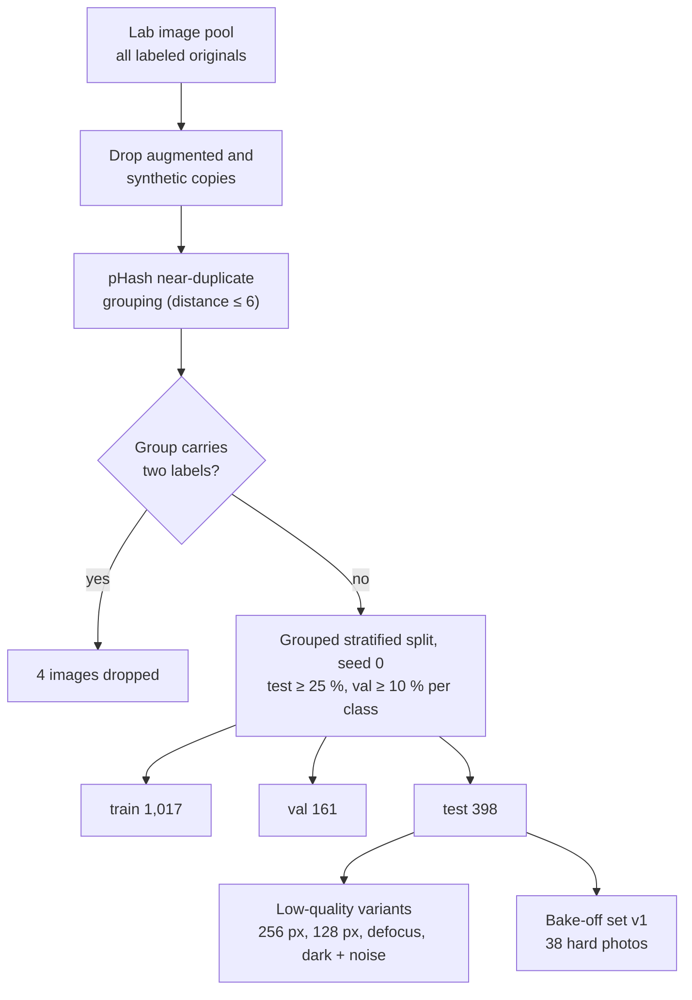

[← README](../README.md) · **Benchmark** · [Classifier](CLASSIFIER.md) · [Synthetic data](SYNTHETIC_DATA.md) · [VLM honesty](VLM_HONESTY.md) · [Captioning](CAPTIONING.md) · [Test-time compute](TEST_TIME_COMPUTE.md) · [Detector](DETECTOR.md) · [Compute](COMPUTE.md) · [Roadmap](ROADMAP.md)

# Benchmark and evaluation protocol

Every number in these pages is measured on the same leak-free split with paired statistics. This page defines the
split, the auxiliary test sets, the statistics, and the known defects of the data. Source of truth for all results:
the lab notebook [`cluster/EXPERIMENT_LOG.md`](../cluster/EXPERIMENT_LOG.md).

## Why a new split

The paper's holdout (70 images) is too small to separate models that differ by 1-3 points, and an audit of the
lab's data found two kinds of leakage:

- **Near-duplicates across splits.** A perceptual-hash audit ([`cluster/benchmark/near_dupes.py`](../cluster/benchmark/near_dupes.py))
  found that 14 of the 161 images that were "clean" by content hash have a visual near-copy (pHash distance ≤ 6:
  resized, recompressed or recropped) in ResNet v4's training data.
- **Label conflicts.** Two near-duplicate groups are filed under two different labels.

The paper's ResNet-50 v4 result was reproduced exactly before anything was changed: on the 68 recoverable holdout
images its predictions match the paper's on 68/68 images (max |Δp| 0.0015), at an accuracy of **60/68**
([`cluster/benchmark/repro_resnet_v4.py`](../cluster/benchmark/repro_resnet_v4.py)).

## Evaluation sets

| Set | Images | Definition | Used for |
|---|---|---|---|
| paper68 | 68 | the paper's holdout (68 of 70 recoverable) | reproduction only |
| resnet161 | 161 | originals not in ResNet v4's training data by content hash | early zero-shot comparisons |
| leak-free 147 | 147 | resnet161 minus 14 visual near-copies of ResNet v4 training images | early zero-shot comparisons |
| all1580 | 1,580 | every original image (no augmented or synthetic copies) | zero-shot VLMs |
| **split v1** | **1,017 / 161 / 398** | grouped train/val/test split of all1580, seed 0 | **main benchmark** |
| 5-fold grouped CV | 1,576 | split v1's images, near-duplicate groups kept within a fold | cheap models (frozen probes) |
| low-quality test | 4 × 398 | split v1 test degraded deterministically (below) | robustness |
| bake-off set v1 | 38 | hard real test photos (faint mold, frost centres, wilting, look-alikes) | captioner evaluation |

**Split v1 test per class:** drought 17, frost 29, gray mold 163, healthy 81, overwatered 19, root rot 33, white mold
56 (built by [`cluster/benchmark/make_split.py`](../cluster/benchmark/make_split.py); file `evaluation/split_v1.json`). No near-duplicate
group crosses train/val/test. Classes are strongly imbalanced, so both accuracy and **macro accuracy** (mean of
per-class accuracies) are reported. With 17-19 test images in drought and overwatered, one image moves a class by
5-6 points.

### Low-quality test suite

[`cluster/classifier/eval_lowq.py`](../cluster/classifier/eval_lowq.py) degrades every split v1 test image in fixed, deterministic ways,
then lets each model resize as usual:

| Variant | Degradation |
|---|---|
| 256 px | longest side 256 px, JPEG quality 50 |
| 128 px thumbnail | longest side 128 px, JPEG quality 35 |
| defocus | Gaussian blur, radius 0.6 % of the long side, JPEG quality 70 |
| dark + noise | brightness × 0.55 plus Gaussian sensor noise (σ = 12), JPEG quality 60 |

## Statistics and protocol

- **Paired tests.** Models are compared on the same images with exact McNemar tests on discordant pairs ("only A
  right / only B right"). Seed-pooled comparisons sum discordant pairs over matched seeds.
- **Seeds.** Every trained model is reported as mean ± sd over 3-5 seeds; single-seed results on this test set move
  by up to ~2.5 points.
- **Intervals.** Wilson intervals for proportions (5-fold CV, claim error rates), bootstrap over images for derived
  metrics (majority votes).
- **Model selection on val only; test scored once** per trained model.
- **Pre-registration.** Ensembles, filters and decision rules are written into the lab notebook *before* the first
  result is seen, and exploratory analyses are labeled as such. Corrections are appended as dated notes, never
  silent edits.
- **Per-image outputs.** Every result file in `evaluation/` stores per-image predictions, so any table can be
  recomputed ([`cluster/benchmark/leaderboard.py`](../cluster/benchmark/leaderboard.py) rebuilds the split v1 leaderboard).

## Known defects of the data

| Issue | Evidence | Status |
|---|---|---|
| Mislabeled images | 11 images flagged both by the out-of-fold CV ensemble and by the 32B annotator; by eye (not a pathologist) ~9 look mislabeled, e.g. a white-mold photo whose overlaid caption reads "Botrytis gray mold", snow-covered plants labeled healthy | listed in `evaluation/label_audit.csv`; **not applied** (`label_corrections_v1.json`, `applied_to_benchmark: false`) pending expert review |
| Gray vs white mold toss-ups | 29 images where the CV ensemble gives the other mold ≥ 0.15; 1 label certainly wrong, 12 need a pathologist; the white-mold class mixes Sclerotinia, Rhizopus leak and early Botrytis | [`cluster/benchmark/mold_tossups.py`](../cluster/benchmark/mold_tossups.py) |
| Text overlays and watermarks | stock photos (shutterstock / alamy / iStock) and captions a VLM can read | flagged by the annotation schema's `image_quality` field |
| Composition shortcut in root rot | the real root-rot class is almost entirely dug-up roots and sliced crowns on plain backgrounds; models learn "roots visible → root rot" | counter-examples added as synthetic data ([Synthetic data](SYNTHETIC_DATA.md)) |
| **Image size predicts the label** | healthy photos are mostly web thumbnails (72 % of test, 83 % of train are ≤ 300 px, median 275 px); white mold is 100 % and gray mold 90-95 % exactly 512 × 512; overwatered, drought and frost are mostly large phone photos (median 600-1024 px). Models trained on it get large healthy photos wrong far more often (62-74 % vs 97-100 % for thumbnails) | measured in [Classifier → resolution shortcut](CLASSIFIER.md#resolution-shortcut); test accuracy should also be reported by photo size, and a field holdout with full-resolution healthy photos is needed |
| Duplicate photo in two formats | a `.jpg` and a `.webp` of the same photo, both in test | counts twice; no leak |

The out-of-fold error analysis of the best ensemble (11 test errors) suggests that **~97-98 % is the ceiling the
current labels allow**: most remaining errors are label noise or genuinely ambiguous photos
([Classifier → error analysis](CLASSIFIER.md#error-analysis-and-the-label-noise-ceiling)).
