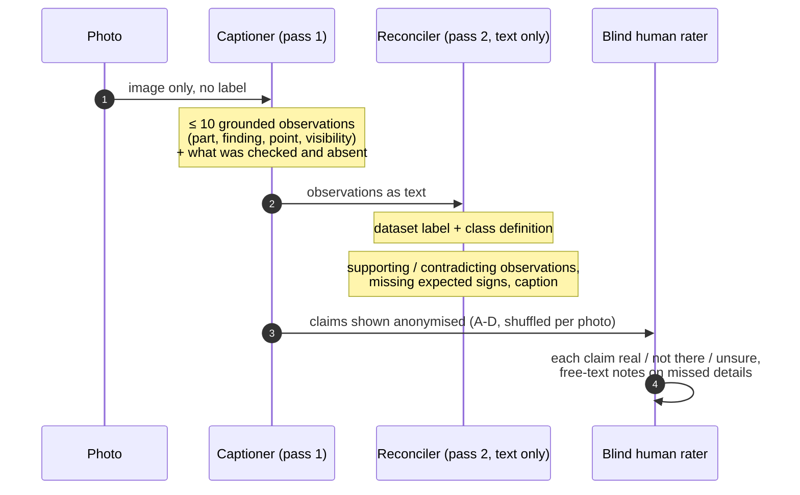
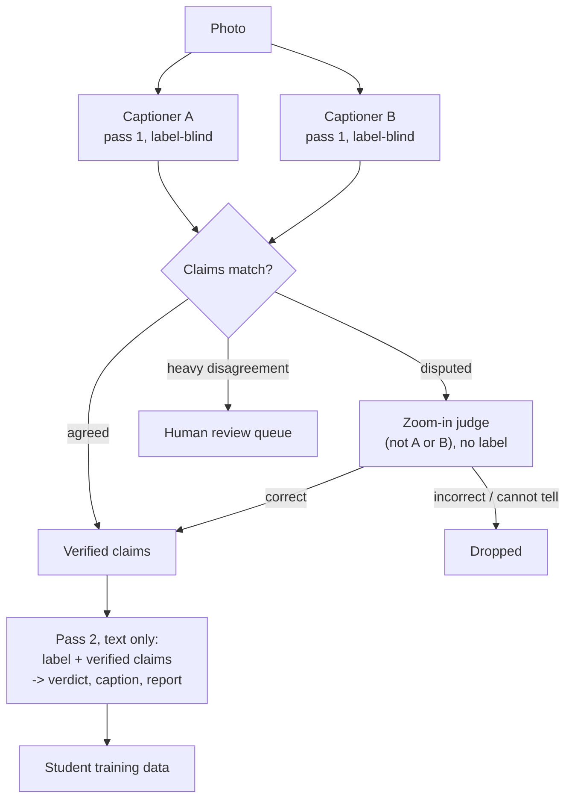

[← README](../README.md) · [Benchmark](BENCHMARK.md) · [Classifier](CLASSIFIER.md) · [Synthetic data](SYNTHETIC_DATA.md) · [VLM honesty](VLM_HONESTY.md) · **Captioning** · [Test-time compute](TEST_TIME_COMPUTE.md) · [Detector](DETECTOR.md) · [Compute](COMPUTE.md) · [Roadmap](ROADMAP.md)

# Local captioning, blind human ratings and hallucination filters

**Context.** The explainer is trained on per-photo annotations ("stage 2"). The paper planned to regenerate them with
a frontier API model; the lab decided against API spending, so annotations must come from open models run locally.
Fine visual details decide this domain (a faint gray-white bloom on a berry, water-soaked tissue, a wilting stem among
upright ones), so the open question is perceptual faithfulness, not fluency.

**Questions.** (1) Which open VLM describes strawberry photos most faithfully? (2) Can its hallucinations be filtered
automatically, and by what mechanism?

**Status (2026-10-21).** Four captioners compared on 38 hard photos; 615 of 845 claims human-rated (interim); four
families of hallucination filters scored on the ratings, including judges at 8B, 27B, 32B and 235B; the
different-family judge (GLM-4.6V) was inconclusive on this runtime. Figures and numbers below are interim where marked.

## 1. Two-pass protocol

Pass 1 is forbidden to name a disease, so the label cannot steer perception; pass 2 never sees the image, so it cannot
add visual claims. Pass 1 is what humans rate. Implementation:
[`cluster/vlm/caption_bakeoff.py`](../cluster/vlm/caption_bakeoff.py) (vLLM, JSON schema enforced during decoding).
The 38 photos (`evaluation/bakeoff_set_v1.json`) are real split v1 test photos chosen to be hard: faint mold
patches, black frost centres, wilting stems, look-alikes, rotted crowns.

## 2. Captioners

| Captioner | Precision, hardware | s / photo | Claims / photo | Pass-2 verdicts (38 photos) | Language slips |
|---|---|---|---|---|---|
| Qwen3-VL-32B-Instruct | bf16, 1 × A100 80 GB | 2.4 | 5.3 | cannot tell 36, partially supports 2 | Chinese text on 15 / 38 photos |
| Qwen3.8-27B | bf16, 1 × A100 80 GB | 1.4 | 5.8 | clearly 8, partially 22, cannot tell 7, does not support 1 | none |
| Qwen3-VL-235B-A22B | AWQ 4-bit, 5 × RTX 5000 Ada (pipeline parallel) | 5.6 | 6.2 | cannot tell 30, clearly 8 | none |
| GLM-4.6V (106B, 12B active) | FP8, 5 × RTX 5000 Ada (pipeline parallel) | 2.9 | 5.0 | cannot tell 19, partially 18, clearly 1 | 1 photo |

All four mark 94-98 % of their own claims "clear", so **self-reported visibility does not separate reliable from
unreliable claims**; only external checks can. Multi-node serving is described in [Compute](COMPUTE.md).

## 3. Blind human ratings (interim)

A review page shows each photo with its label and definition and every captioner's claims with point markers.
Captioners are anonymised as A-D with a seeded per-photo shuffle drawn from the full four-model list (so adding a
model later never re-letters existing ratings); the key is withheld until scoring.

<picture>
  <source media="(prefers-color-scheme: dark)" srcset="figures/examiner_errors_dark.png">
  
</picture>

| Captioner | Claims rated | Not there (95 % CI) | Unsure | Photos with ≥ 1 false claim | Mold seen (13 mold photos) |
|---|---|---|---|---|---|
| Qwen3-VL-32B | 174 | **4.0 %** (2.0-8.1) | 10 % | 4 / 34 | 9 / 13 |
| GLM-4.6V | 40 | 5.0 % (1.4-16.5) | 18 % | 2 / 9 | not yet rated |
| Qwen3.8-27B | 197 | 10.2 % (6.7-15.2) | 6 % | 10 / 34 | 11 / 13 |
| Qwen3-VL-235B-A22B | 204 | 10.3 % (6.8-15.2) | 4 % | 16 / 34 | 11 / 13 |

- Per photo, 235B vs 32B: 14 photos worse / 4 better (sign test p = 0.03); the other pairs are not significantly
  different (235B vs 27B p = 0.65; 32B vs 27B p = 0.27).
- On the 9 photos rated for all four captioners (frost, healthy, root rot) all four are alike (3.6-5.6 % false);
  the differences come from the mold and water-stress photos.
- The captioner with the fewest false claims also misses the most mold (9 / 13) and has more of its claims rated
  "unsure" than the 27B and 235B (10 % vs 4-6 %): **fewer false claims is not the same as better perception.**

**Caveats.** One rater so far (inter-rater agreement pending a second rater). Claim length differs about 3× between
captioners, so per-claim rates will be normalised at final scoring (the mapping is withheld here to keep the remaining
ratings blind). GLM-4.6V was added after photos 0-24 were rated, so on those photos the rater can infer which letter
is the late addition; GLM will be reported with and without them.

## 4. Hallucination filters

Four families of automatic filters were pre-registered in the lab notebook before any filter result was seen:

| Filter | Mechanism | Extra compute |
|---|---|---|
| (a) cross-model agreement | keep a claim if another captioner made a matching claim (same polarity, shared condition keyword, points within 150 of 1000) | none |
| (b) self-consistency | re-run the same captioner 3× with sampling (T = 0.7); keep claims that recur in ≥ 2 of 3 | 3 × pass 1 |
| (c) agreement, else self-consistency | lab proposal: keep agreed claims; a disputed claim survives only if its own model repeats it | 3 × pass 1 |
| (d) zoom-in judge | a VLM sees the whole photo with a red box around the claimed point (plus, in zoom mode, an enlarged crop of the box), without the label, and answers correct / incorrect / cannot tell ([`cluster/vlm/judge_claims.py`](../cluster/vlm/judge_claims.py)) | 1 call per claim |

<picture>
  <source media="(prefers-color-scheme: dark)" srcset="figures/hallucination_filters_dark.png">
  
</picture>

Common set: 562 rated claims (515 real, 47 not there) with valid outputs from every filter. Each judge drops the
claims it calls *incorrect* or *cannot tell*.

| Filter | False claims removed | Real claims removed | False removed per real removed | AUROC |
|---|---|---|---|---|
| (a) cross-model agreement | 59.6 % | 41.7 % | 1.4 | 0.61 |
| (b) self-consistency, ≥ 2 of 3 | 66.0 % | 52.0 % | 1.3 | 0.53 |
| (c) agreement, else self-consistency | 51.1 % | 34.6 % | 1.5 | — |
| (d) Qwen3-VL-8B judge, whole photo | **59.6 %** | 21.4 % | 2.8 | **0.69** |
| (d) Qwen3-VL-8B judge + zoom | 48.9 % | 16.3 % | 3.0 | 0.66 |
| (d) Qwen3.8-27B judge, whole photo | 31.9 % | **8.5 %** | 3.7 | 0.62 |
| (d) Qwen3.8-27B judge + zoom | 36.2 % | 9.9 % | 3.7 | 0.63 |
| (d) Qwen3-VL-32B judge, whole photo | 38.3 % | 10.5 % | 3.6 | 0.64 |
| (d) Qwen3-VL-32B judge + zoom | 44.7 % | 12.8 % | 3.5 | 0.66 |
| (d) Qwen3-VL-235B judge + zoom | 29.8 % | 8.2 % | 3.6 | 0.61 |
| exploratory: ≥ 2 of the 3 judges say *incorrect*, whole photo | 36.2 % | 7.2 % | **5.0** | — |

AUROC: real vs not-there claims, with correct = 1, cannot tell = 0.5, incorrect = 0 for judges and the count of
agreeing models or recurring repeats for (a) and (b); 0.5 = chance.

**Findings.**

1. **Cheap consistency checks are weak filters.** Each removes a third to a half of the *real* details to remove half
   to two-thirds of the false ones. Self-consistency is close to chance (AUROC 0.53) because real details are unstable
   across samples: 32 % of real claims never recur in 3 repeats, since a model mentions different details each time
   it looks.
2. **Shared blind spots defeat agreement.** On one overwatered photo, three of four captioners (including GLM-4.6V,
   the only non-Qwen model) described normal stem hairs as cottony or fuzzy growth; on another, three asserted
   "no water-soaked patches" and only one saw the lesion. A majority vote picks the wrong answer on both, and the
   false mold claim is exactly the error the v1 pipeline made.
3. **Re-examining the claim works better than counting votes, even with a small judge.** Every judge removes 2.8-3.7
   false claims per real claim lost, against 1.3-1.5 for the consistency checks. The 8B judge on the whole photo
   removes as many false claims as agreement (59.6 %) at half the cost in real claims (21.4 vs 41.7 %) and has the
   highest AUROC (0.69). Judges differ mostly in strictness: the 8B rejects more of both kinds, the 27B and the 235B
   are the most permissive (the 235B calls 90 % of claims correct). **Judge quality does not grow with size:**
   AUROC 8B 0.66-0.69 ≥ 32B 0.64-0.66 > 27B 0.62-0.63 ≈ 235B 0.61. A majority of the three smaller judges
   (exploratory) reaches 5.0 false claims per real claim.
4. **The zoomed crop has no consistent effect.** AUROC changes by +0.03 (32B), +0.01 (27B) and −0.02 (8B). The
   pre-registered prediction that zoom beats the whole photo is not supported at these settings (crop side 35 % of
   the short side, enlarged to 896 px).
5. **Self-verification is unresolved.** The 32B judging its own claims scored near chance (AUROC 0.43-0.54 on 153
   claims, only 7 of them false), but the 27B judging its own claims (186 claims, 20 false) scored 0.59-0.66 and the
   235B (196 claims, 21 false) 0.62, the same as on other captioners' claims (0.60-0.62 and 0.61). These data do not
   show that a model cannot verify its own claims.
6. **Look-alikes remain.** All four judges, in every mode, accept the stem-hair "cottony growth" claims (and all
   confirm the one real lesion claim on the other photo). Normal anatomy that resembles a disease sign needs domain
   knowledge in the prompt or a human.

**Yes-bias check with decoys.** Each photo also received up to 4 decoys: a definite disease-sign claim taken from a
photo of another condition group, boxed on the same plant part. Accepted as correct overall: 8B 9 % (whole photo) /
13 % (zoom), 27B 23 % / 19 %, 32B 19 % / 15 %, 235B 19 % (zoom) of 134-135 decoys; but inspection showed that
generic decoys ("brown, necrotic tissue") are often true on the target photo by chance. On the clean subset (mold
signs placed on non-mold photos, n = 33): **8B 3.0 % / 9.1 %, 27B 15.2 % / 12.1 %, 32B 12.1 % / 9.1 %, 235B 9.1 %**. This subset was chosen after seeing
the decoy results and is reported as such.

## 5. Open questions

| Experiment | Question | Models |
|---|---|---|
| Cross-family judge | does a non-Qwen judge verify better than the Qwen judges above? | GLM-4.6V: **inconclusive** on this stack: 9-13 % of outputs degenerate into repeated text, and the parsed ones call nearly every claim correct (AUROC 0.51, 49-61 % of decoys accepted). Needs another runtime (e.g. transformers) before any conclusion |

Diagnosis-level consensus (voting over samples, two-answer captions, debate, reference images) and the answer-format
ablation are reported in [Test-time compute](TEST_TIME_COMPUTE.md). Pre-registrations, predictions and results are
appended to [`cluster/EXPERIMENT_LOG.md`](../cluster/EXPERIMENT_LOG.md).

## Proposed annotation pipeline (pending the results above)

Agreement alone is not trusted for disease signs with known look-alikes (finding 2). Using a judge that is not one
of the two captioners is a precaution, not an established requirement (finding 5); a small judge is sufficient on
current evidence (finding 3).
