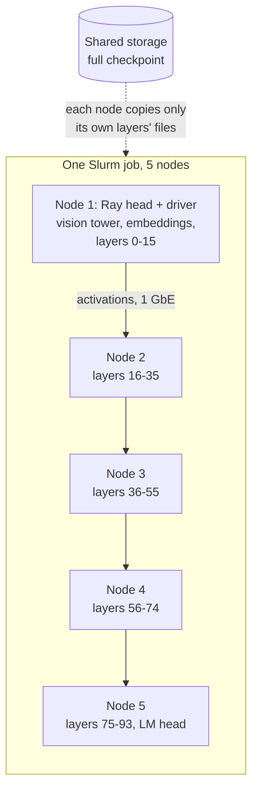

[← README](../README.md) · [Benchmark](BENCHMARK.md) · [Classifier](CLASSIFIER.md) · [Synthetic data](SYNTHETIC_DATA.md) · [VLM honesty](VLM_HONESTY.md) · [Captioning](CAPTIONING.md) · [Test-time compute](TEST_TIME_COMPUTE.md) · [Detector](DETECTOR.md) · **Compute** · [Roadmap](ROADMAP.md)

# Compute and reproducibility

All revival experiments ran on the university's Slurm cluster. Every experiment is a script in
[`cluster/`](../cluster/README.md) (grouped by study), every result file stores per-image outputs in `evaluation/`, and
every run is recorded in [`cluster/EXPERIMENT_LOG.md`](../cluster/EXPERIMENT_LOG.md) with its job ID. Script index:
[`cluster/README.md`](../cluster/README.md); multi-node launchers: [`cluster/slurm/`](../cluster/slurm/).

## Hardware

| Partition | Nodes | GPU per node | Used for |
|---|---|---|---|
| `research-gpu` | 6 | 1 × RTX 5000 Ada, 32 GB | backbone fine-tunes, LoRA, RF-DETR, single-GPU vLLM, multi-node pipeline-parallel vLLM |
| `a100` | 1 | 1 × A100, 80 GB | 27-32B models in bf16, large fine-tunes (PE-Core-G), annotation runs |
| `research` | 8 (shared with the GPU nodes) | none requested | CPU jobs: scoring and reports |

- **One GPU per node** caps a single-node job at ~32 GB of VRAM (80 GB on the A100). Larger models are split across
  nodes.
- **Interconnect: 1 Gb Ethernet.** The nodes have ConnectX-4 Lx 10 GbE ports linked but not configured, and no
  InfiniBand. A request to configure them (IPs on the storage network, jumbo frames, RoCE v2) is pending with IT.
- **Shared storage is slow** (~65 MB/s per stream over NFS); node-local NVMe is fast. Models are staged to local NVMe
  before loading ([`cluster/infra/stage_model.sh`](../cluster/infra/stage_model.sh)): load time 296 → 5 s for an 8B, 928 → 69 s
  for a 32B.

## Software environments

Plain venvs on shared storage (conda hung on the shared filesystem), built by
[`cluster/infra/hamilton_setup_envs.sh`](../cluster/infra/hamilton_setup_envs.sh) and
[`cluster/infra/setup_vision_env.sh`](../cluster/infra/setup_vision_env.sh):

| Environment | Key versions | Used for |
|---|---|---|
| `minigptv` | torch 2.5.1 + cu121, **transformers 4.45.2**, peft 0.11.1, bitsandbytes 0.43.3, gradio 4.44.1 | the v1 pipeline (MiniGPT-v2, demo) |
| `rfdetr` | rfdetr 1.11.2 (`[train,loggers]`), torch 2.14 + cu130, portable Python 3.11 | detector training and evaluation |
| `vision` | timm, open_clip, diffusers | backbone probes and fine-tunes, synthetic images, scoring |
| `vllm` | vLLM 0.32 | all VLM inference: zero-shot, annotation, captioning, judging |

**v1 pipeline note.** MiniGPT-v2 needs transformers **4.45.2**, not the 4.41.1 in the original instructions. Under
4.41 the lab's `cache_position` shim hides the forward signature, `generate()` builds no attention mask and re-feeds
every generated token, so the KV cache grows quadratically (OOM on 32 GB, repetitive text).

## Serving models larger than one GPU

Qwen3-VL-235B-A22B (AWQ, ~125 GB) and GLM-4.6V (FP8, ~110 GB) do not fit on one node. They run with vLLM pipeline
parallelism across five RTX nodes on a Ray cluster started inside one Slurm job
([`cluster/slurm/vllm_ray.sbatch`](../cluster/slurm/vllm_ray.sbatch)). Only activations cross the network between
stages, so 1 GbE is sufficient for batch inference.

Each node stages only the weight files of its own layer range plus the small non-layer files
([`cluster/infra/stage_pp_shard.py`](../cluster/infra/stage_pp_shard.py)): ~25-29 GB per node instead of the full 110-125 GB.
The layer split is set with `VLLM_PP_LAYER_PARTITION` (235B: 16, 20, 20, 19, 19; GLM-4.6V: 7, 10, 10, 10, 9).

Lessons that cost a failed run each:

| Problem | Cause | Fix |
|---|---|---|
| "weight files referenced in index but missing" | vLLM rejects an index that names files absent on that node | write a per-node index listing only staged files |
| wrong layers on a node | vLLM 0.32 orders pipeline ranks by driver first, then by the random Ray node ID | start Ray first, query the order ([`cluster/infra/ray_pp_order.py`](../cluster/infra/ray_pp_order.py)), then stage |
| silent garbage risk | quantized checkpoints skip vLLM's missing-weights check | the rank mapping above must be right; verify outputs |
| "Stale file handle" at start-up | five nodes compiling the same Triton kernels into one NFS cache | Triton / vLLM / Inductor caches on node-local disk |
| KV cache too small on one stage | uneven memory per stage | re-balance the layer split; `--max-model-len 8192`, `--enforce-eager`, `--gpu-mem 0.95` |
| anyone on the network could submit work to the Ray cluster | Ray's default has no authentication | Ray token authentication enabled |
| a model emits degenerate text ("…lock…lock…") or grammar errors on some runs only | node c5's local disk returned corrupted data for weight files that had been copied correctly (same size, different bytes; right after a copy the page cache hides it), and vLLM does not verify quantized weights | c5 excluded and reported; every staged file is now checked against a per-model `SHA256SUMS` manifest, read from disk with the page cache evicted ([`cluster/infra/verify_staged.py`](../cluster/infra/verify_staged.py), [`cluster/infra/make_manifest.py`](../cluster/infra/make_manifest.py)) |

## Other throughput notes

- **vLLM vs transformers.** Schema-constrained annotation with vLLM: 8B ~1,000-1,300 output tokens/s on an RTX 5000
  Ada (~1 s per annotation), 32B bf16 ~480 tokens/s on the A100 (~2 s), against 109 s per annotation with
  transformers + 4-bit bitsandbytes. Requirements: a `__main__` guard (vLLM spawns its engine process),
  `VLLM_USE_FLASHINFER_SAMPLER=0` (no CUDA toolkit on the nodes for FlashInfer's JIT), bounded JSON schemas.
- **Qwen-VL patch embedding.** The Conv3d patch embedding (kernel = stride) replaced by an equivalent `F.linear`:
  8B inference 9.73 → 0.22 s per image under transformers.
- **Multi-node LoRA training over 1 GbE** works (bf16 all-reduce of ~143M adapter parameters per step): 2 nodes
  3.07 s/image/GPU (25 % gradient sync), 3 nodes 3.02 s/image/GPU (35 % sync), ~2.3× one GPU. Configuring the 10 GbE
  ports would cut the sync time ~10×.

## Reproducing a result

1. Find the entry in [`cluster/EXPERIMENT_LOG.md`](../cluster/EXPERIMENT_LOG.md); it names the job ID, the script
   and the result file.
2. Run the same script with the logged arguments, from the repository root on the cluster, after
   `source agai_env.sh` ([`cluster/infra/agai_env.sh`](../cluster/infra/agai_env.sh)). The notebook names scripts by
   their flat cluster path (`cluster/<script>`); [`cluster/README.md`](../cluster/README.md) gives each one's folder.
   A single-GPU job stages the model (`cluster/infra/stage_model.sh`) and runs the script; multi-node jobs use the
   launchers in [`cluster/slurm/`](../cluster/slurm/).
3. Rebuild tables from the per-image result files ([`cluster/benchmark/leaderboard.py`](../cluster/benchmark/leaderboard.py),
   [`cluster/benchmark/compare_results.py`](../cluster/benchmark/compare_results.py), [`cluster/vlm/score_honesty.py`](../cluster/vlm/score_honesty.py)).
4. Figures in these pages: `python docs/figures/make_figures.py`.
