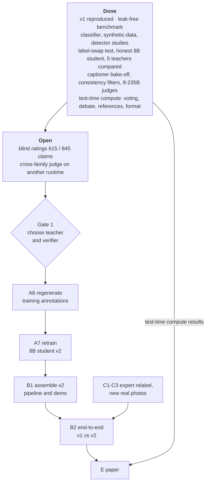

[← README](../README.md) · [Benchmark](BENCHMARK.md) · [Classifier](CLASSIFIER.md) · [Synthetic data](SYNTHETIC_DATA.md) · [VLM honesty](VLM_HONESTY.md) · [Captioning](CAPTIONING.md) · [Test-time compute](TEST_TIME_COMPUTE.md) · [Detector](DETECTOR.md) · [Compute](COMPUTE.md) · **Roadmap**

# Roadmap: what is done, what is running, what is next

Last updated 2026-10-22. Each task lists what "done" means. Status of every experiment is tracked in
[`cluster/EXPERIMENT_LOG.md`](../cluster/EXPERIMENT_LOG.md).

## Overview

## A. Annotation and explainer (critical path)

| # | Task | Done when | Depends on |
|---|---|---|---|
| A1 | Finish the blind ratings (230 claims left: GLM-4.6V on photos 0-24, all captioners on photos 31-34) | 845 / 845 rated | — |
| A2 | Second rater on a subset (≥ 10 photos, all captioners) | inter-rater agreement (Cohen's κ) reported | page sharing: raters must be invited with edit rights |
| A3 | Cross-family judge: GLM-4.6V was inconclusive on vLLM (degenerate outputs); retry a non-Qwen judge with transformers or another model, or drop the question | a non-Qwen judge scored on the common claim set | each result appended to the log against its pre-registration | jobs in queue |
| A4 | Final captioner scoring with claim-length normalisation and the GLM-4.6V blinding caveat | table of error rate, mold recall, missed-detail rate per captioner | A1 |
| A5 | **Gate 1:** choose the teacher and the verifier | written rationale: label-swap balanced honesty, true condition in differential, human-rated claim error, mold recall, throughput | A3, A4 |
| A6 | Regenerate training annotations for train (+ val) with the two-pass protocol, filtered by the verifier | annotation files + a human spot check of ≥ 50 photos | A5 |
| A7 | Retrain the 8B student on A6 and re-run the label-swap test and a claim-level check on the bake-off set | student v2 vs v1 table with paired tests | A6 |
| A8 | ~~Annotation-schema order: verdict first vs observations first~~ **Done 2026-10-22:** no general effect on balanced honesty; for the 32B observations-first is more sceptical (keep it) ([VLM honesty](VLM_HONESTY.md#does-the-order-of-the-schema-matter)). Still open: an image-in-the-loop check for "sign absent" statements | label-swap honesty for both orders (done); claim-level check open | before A6 |

## B. Integration and end-to-end evaluation

| # | Task | Done when | Depends on |
|---|---|---|---|
| B1 | Assemble the v2 pipeline: SigLIP 2 classifier (recommended data recipe; seed ensemble optional) + RF-DETR Large + 8B honest student, in a new demo entry point | demo runs on one 32 GB GPU; latency and VRAM measured | A7 |
| B2 | End-to-end v1 vs v2 on split v1 test | one table: accuracy / macro, label-swap honesty, claim-level faithfulness, latency, VRAM | B1 |
| B3 | RF-DETR on/off ablation (the paper's planned experiment) on honesty and claim-level metrics | effect of grounding measured, not just mAP | B1 |
| B4 | Use sampling for uncertainty, not accuracy: abstain or show a two-answer differential when the vote share is low or models disagree (debate and reference images do not enter the product: no accuracy gain) | thresholds chosen on val; coverage / accuracy curve on test | test-time compute results (done) |

## C. Data

| # | Task | Done when | Notes |
|---|---|---|---|
| C1 | Expert relabel of the 11 doubly flagged images and the 12 gray/white mold toss-ups | split v1.1 with a change list; results re-scored on both | candidates in `evaluation/label_audit.csv`; nothing has been changed yet |
| C2 | Flag or remove watermarked and text-overlay images from the test split | test-set manifest with flags | a VLM can read overlaid captions |
| C3 | **Collect real photos for drought, overwatered and frost** (e.g. a small greenhouse stress trial with phone photos) | ≥ 100 real images per weak class, grouped by plant and session | the only lever on the ~97-98 % label-limited ceiling; no public strawberry data exists for these classes |
| C4 | Re-define or split the white-mold class (Sclerotinia vs Rhizopus leak vs early Botrytis) | class definition agreed with a pathologist | drives most mold confusions |
| C6 | **Break the size confound:** full-resolution healthy photos (field), every class trained with randomised resolution (stronger than `--lowq-aug 0.3`), and test accuracy reported by photo size | large healthy photos ≥ 90 % correct; P(healthy) no longer rises when large healthy photos are shrunk | [Classifier → resolution shortcut](CLASSIFIER.md#resolution-shortcut) |
| C5 | Detector test split | RF-DETR / SAM 3 numbers on unseen images | [Detector](DETECTOR.md) |

## D. Infrastructure and release

| # | Task | Done when |
|---|---|---|
| D1 | IT: configure the 10 GbE ports (IPs on the storage network, jumbo frames, RoCE v2) | multi-node LoRA sync ~10× faster; faster weight staging |
| D1b | IT: node c5's `/scratch` returns corrupted data (hash evidence in the lab notebook, 2026-10-22); until fixed, jobs use `--exclude=c4,c5`, which leaves 4 RTX nodes (too few for the 100B+ models while c4 is busy) | c5 checked / repaired by IT; a re-run of one c5-involved result matches |
| D2 | Merge `cluster/` and `docs/` into the lab repository | scripts and docs on the lab's default branch |
| D3 | Release plan: model licences (Qwen, GLM, LLaMA 2 for v1) and image licences (many training images are web images that cannot be redistributed) | written release policy; which weights and which data can be published |

## E. Paper

Proposed structure, mapped to existing results:

| Section | Claim | Evidence |
|---|---|---|
| Benchmark | the paper's holdout leaks and is too small; a grouped split and paired statistics are needed | [Benchmark](BENCHMARK.md) |
| Diagnosis | modern backbones beat ResNet-50 by ~5 points with the same recipe; ensembles reach the label-noise ceiling | [Classifier](CLASSIFIER.md) |
| Data | synthetic data must be designed against shortcuts; robustness comes from degradation | [Synthetic data](SYNTHETIC_DATA.md) |
| Honesty | an explainer must be able to reject its input label; filtered distillation achieves it | [VLM honesty](VLM_HONESTY.md) |
| Faithfulness | human-rated claim-level evaluation of open captioners; consistency checks vs verification | [Captioning](CAPTIONING.md) |
| Test-time compute | voting, debate and reference images do not substitute for training; explaining before answering hurts; sampling is an uncertainty signal | [Test-time compute](TEST_TIME_COMPUTE.md) |
| System | v1 vs v2 end to end | B2 (pending) |

Threats to validity to state explicitly: label noise (~9 suspected errors in test), small weak classes (17-29 test
images), a single human rater so far, synthetic images in training only, web images of unknown provenance.

## Decisions and open questions

| Question | Options | Evidence that decides it |
|---|---|---|
| Which teacher writes the training annotations? | Qwen3-VL-32B (current, 77.6 %) or Qwen3-VL-235B (80.7 %, p = 0.029, ~4× the GPU time); Qwen3.8-27B and GLM-4.6V (64.1 %) ruled out | human-rated claim faithfulness (A4) and cost; [VLM honesty](VLM_HONESTY.md) |
| Which verifier filters claims? | the 8B judge (best AUROC, strict) or a 3-judge majority (best ratio, exploratory); the 235B is no better (AUROC 0.61); the GLM-4.6V judge was inconclusive on this runtime | A3; a fresh rated set to confirm the exploratory majority rule |
| Should uncertain cases produce two-answer captions ("A or B; check X")? | single diagnosis vs differential captions | evidence so far favours it: when two models disagree the truth is one of their two answers 68-74 % of the time vs 30-40 % for either ([Test-time compute § 2](TEST_TIME_COMPUTE.md#2-two-models-disagreement-two-answer-captions-debate-and-references)); remaining question is how the student learns it |
| Is a VLM needed at inference for the label? | no: the classifier decides, the VLM explains | [Classifier](CLASSIFIER.md): fine-tuned 8B 94.2 % < SigLIP 2 95.6 % |
