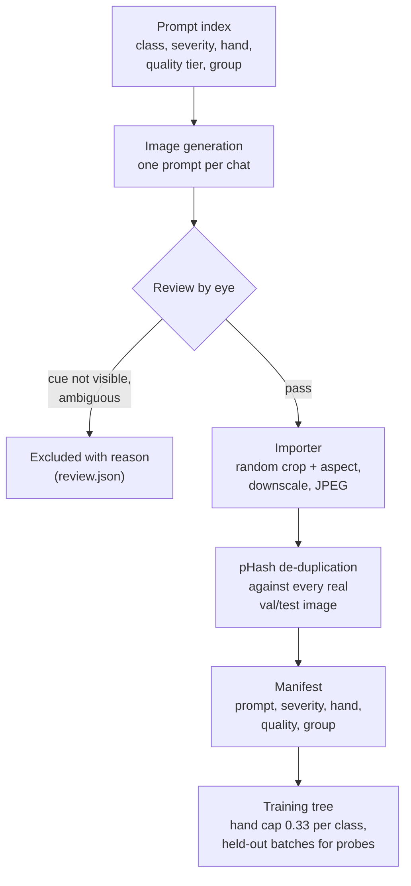

[← README](../README.md) · [Benchmark](BENCHMARK.md) · [Classifier](CLASSIFIER.md) · **Synthetic data** · [VLM honesty](VLM_HONESTY.md) · [Captioning](CAPTIONING.md) · [Test-time compute](TEST_TIME_COMPUTE.md) · [Detector](DETECTOR.md) · [Compute](COMPUTE.md) · [Roadmap](ROADMAP.md)

# Synthetic data and robustness to poor photos

**Question.** The weak classes (drought, frost, overwatered) have 17-29 real test images and few training images.
Can generated images fill the gap, and what makes a synthetic set help rather than hurt?

**Findings.**
1. The lab's 601 GPT-generated images give **no net gain** (5 ResNet seeds, 3 SigLIP 2 seeds). They move the
   drought/overwatered decision boundary instead of sharpening it.
2. A set designed against the dataset's shortcuts (look-alikes, balanced nuisance factors, healthy roots) **removes a
   confirmed shortcut** ("roots visible → root rot") without hurting clean accuracy, once one over-represented batch
   is removed.
3. **Robustness to low-detail photos comes from train-time degradation**, not from prompting for "low-quality"
   images: 128 px thumbnail accuracy 83.7 → 92.1 % while clean accuracy is unchanged.

**Recommended training data:** real photos + the designed ChatGPT set without the frost_3-5 batch +
`train_backbone.py --lowq-aug 0.3` (SigLIP 2: 96.3 ± 0.8 % clean, 92.1 % on 128 px thumbnails, 3 seeds).

## 1. The lab's GPT synthetic set (601 images)

Generated with the OpenAI image API in April 2026 (`plant_diagnostic/data/train_aug/<class>/synth_*GPT*`); one
exact duplicate dropped, none a near-copy of any val/test image. Real-only val/test throughout.

- ResNet-50, 5 seeds: 90.4 ± 0.9 % with vs 90.2 ± 1.5 % without. SigLIP 2, 3 seeds: 95.7 ± 1.0 vs 95.6 ± 1.3 %
  (pooled McNemar 23 / 21, p = 0.88).
- Per class it is not noise; both architectures show the same pattern:

| Class (test n) | Real only | + lab synth | Δ SigLIP 2 | Δ ResNet-50 (5 seeds) |
|---|---|---|---|---|
| drought (17) | 92.2 | 76.5 | **−15.7** | −16.5 |
| overwatered (19) | 84.2 | 93.0 | **+8.8** | +8.4 |
| frost (29) | 97.7 | 100.0 | +2.3 | +0.7 |
| root rot (33) | 97.0 | 100.0 | +3.0 | −1.8 |
| gray mold (163) | 97.5 | 99.0 | +1.4 | +2.1 |
| healthy (81) | 93.0 | 90.1 | −2.9 | +1.0 |
| white mold (56) | 96.4 | 96.4 | 0.0 | −3.2 |

Mechanism (confusions summed over 3 seeds): real-only models call overwatered photos "drought" 9 times and drought
photos "overwatered" once; with the lab set it is 1 and 7. **The synthetic images shift the boundary between the two
water-stress classes; the overwatered gain is paid for by drought.** This plausibly explains why the set was
remembered as a win: the lab's own holdouts contained synthetic images, and overwatered (a weak class) does improve.

## 2. A synthetic set designed against shortcuts

Generated with ChatGPT's image tool (web interface, not the API), every image reviewed by eye before import.
248 generated, **238 kept** (10 excluded with a recorded reason, e.g. cue not visible, ambiguous frost colouring).

Design rules, each motivated by an observed failure:

| Rule | Motivation |
|---|---|
| Nuisance factors balanced across classes: hands/gloves ≤ ~25-33 % of every class, same settings, viewpoints, lighting | a factor that co-occurs with one class becomes a shortcut |
| Severity mix (mild / moderate / severe) plus a healthy look-alike for every stress (wet soil after rain, dry topsoil, dew, yellow-centred flowers, an old red lower leaf, clean roots) | teach the symptom, not the context |
| Roots lying on the ground, on a bench, in hand and as cut crowns for **both** healthy and root rot | the real root-rot class is almost all dug-up roots, so "roots visible" predicts the label |
| Phone-camera deep focus, no bokeh or cinematic light; ~40 % "genuinely low quality" prompts | early images looked like stock photography |
| Mild or small cues never combined with low quality or distant shots | an invisible cue is label noise |

The importer ([`cluster/synthetic/import_synth.py`](../cluster/synthetic/import_synth.py)) random-crops to random aspect ratios,
downscales and JPEG-compresses every image, because raw generator outputs are pristine PNGs in a few fixed sizes (an
easy shortcut). Training trees are built by [`cluster/synthetic/build_train_tree.py`](../cluster/synthetic/build_train_tree.py), which
enforces the hand cap and can hold out whole batches as a shortcut probe. Added to training: drought +50, frost +46,
healthy +50, overwatered +46, root rot +43 (235 synthetic vs 1,017 real).

## 3. Results

SigLIP 2 so400m fine-tunes with the lab recipe, 3 seeds per arm, real split v1 test (398) and the low-quality test
suite ([Benchmark](BENCHMARK.md#low-quality-test-suite)). McNemar = pooled discordant pairs vs real only over the 3
seed pairs.

<picture>
  <source media="(prefers-color-scheme: dark)" srcset="figures/synthetic_lowq_dark.png">
  
</picture>

| Training data | Clean test | Macro | 128 px (macro) | 256 px | Defocus | Dark + noise | vs real only |
|---|---|---|---|---|---|---|---|
| real only | 95.6 ± 1.3 | 94.0 | 83.7 (78.5) | 94.3 | 93.1 | 93.6 | — |
| + lab GPT synthetic (601) | 95.7 ± 1.0 | 93.6 | 85.8 (78.2) | 95.1 | 93.9 | 94.8 | 23 / 21, p = 0.88 |
| + ChatGPT set, first 165 | 96.0 ± 0.4 | 94.1 | 77.9 (69.2) | 93.6 | 92.2 | 93.5 | 21 / 16, p = 0.51 |
| + ChatGPT set, all 235 | **94.2 ± 1.5** | 92.2 | 83.0 (73.6) | 91.9 | 90.9 | 92.2 | 14 / 30, **p = 0.02** |
| + ChatGPT set without frost 3-5 | 96.1 ± 1.0 | 94.7 | 81.9 | — | — | — | 23 / 16, p = 0.34 |
| real only + low-quality aug. | 95.1 ± 1.0 | 93.3 | 90.0 (87.0) | 94.1 | 92.0 | 93.8 | 12 / 18, p = 0.36 |
| + ChatGPT set + low-quality aug. | 95.7 ± 0.8 | 93.6 | 91.6 (89.6) | 95.1 | 93.0 | 94.4 | 22 / 20, p = 0.88 |
| **+ ChatGPT set w/o frost 3-5 + low-quality aug.** | **96.3 ± 0.8** | 94.3 | **92.1 (88.5)** | 96.1 | — | 95.8 | 21 / 12, p = 0.16 |

### Low-detail robustness

Without augmentation, thumbnails collapse exactly the classes that need data (real only at 128 px: drought 59 %,
frost 62 %, overwatered 68 %; healthy and root rot stay ~97-99 %). Adding the designed synthetic set *without*
augmentation made this worse (128 px 77.9 % for the first arm): the look-alikes teach that wet or dry soil and
visible roots alone are not disease, so when a thumbnail destroys the plant-level symptoms the model falls back to
"healthy". Train-time phone degradation, applied to every class with probability 0.3 (long side 96-320 px, JPEG
quality 25-70, sometimes blur or darkening + noise; `--lowq-aug` in
[`cluster/classifier/train_backbone.py`](../cluster/classifier/train_backbone.py)), fixes it: 128 px drought 59 → 78 %, frost 62 → 80 %,
overwatered 68 → 95 %, and thumbnails wrongly called healthy 108 → 8 (3 seeds), with clean accuracy unchanged.

### The roots shortcut

A held-out synthetic probe ([`cluster/classifier/eval_probe.py`](../cluster/classifier/eval_probe.py); batches generated after the first
arm was trained; a diagnostic, not a benchmark) contains six photos of **healthy dug-up roots**. Models trained on
real data only, or with the lab's set, call 0-1 of 6 healthy (the rest "root rot"); models trained with the designed
set call 5-6 of 6 healthy, while rotted roots stay 8/8. Over the whole 70-image probe: real only 57-66 %, lab set
74-83 %, designed set 89-96 %.

### The over-represented frost batch

The full set without augmentation was significantly worse than real only (p = 0.02): healthy → frost errors rose
9 → 12, plus a new frost → gray mold confusion. The 70 images added after the first arm were mostly 30 frost images
generated one prompt per chat (black flower centres, browned blossoms). Removing that batch (frost_3-5) removes the
harm (96.1 ± 1.0 %). The batch is not mislabeled (83-93 % of models that never saw it still call it frost); it
over-weights "white flower with a dark centre" and pulls real healthy flowers toward frost.

## Caveats

- Differences among the top arms (95.7-96.3 %) are within seed noise; the robustness gains and the roots probe are
  not.
- The held-out roots probe exists only for the first arm; later arms trained on every synthetic batch.
- The two best arms trained on the A100 without gradient checkpointing, the other arms on RTX nodes with it (same
  recipe and seeds).
- Synthetic images are used for training only; every validation and test image is a real photo.
