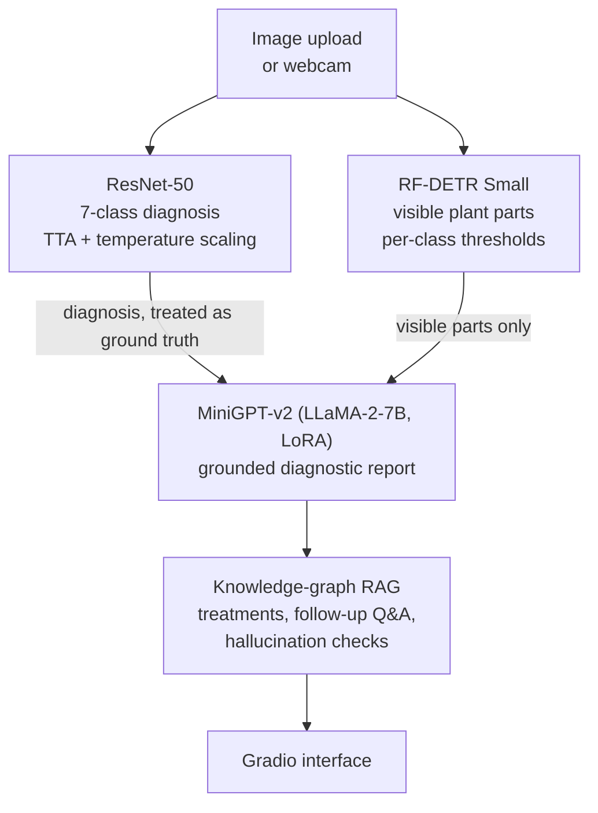

[← README](../README.md) · [Benchmark](BENCHMARK.md) · [Classifier](CLASSIFIER.md) · [Synthetic data](SYNTHETIC_DATA.md) · [VLM honesty](VLM_HONESTY.md) · [Captioning](CAPTIONING.md) · [Test-time compute](TEST_TIME_COMPUTE.md) · [Detector](DETECTOR.md) · [Compute](COMPUTE.md) · [Roadmap](ROADMAP.md)

# The v1 system (paper version)

This page preserves the documentation of the system described in [RESEARCH_PAPER.pdf](../RESEARCH_PAPER.pdf): a
ResNet-50 classifier, an RF-DETR Small plant-part detector and a LoRA-adapted MiniGPT-v2 explainer behind a Gradio
interface. The revival's measurements of each component are on the other pages; corrections found during the
revival are marked **Revival note**.

## How it works



1. **ResNet-50 classification.** A fine-tuned ResNet-50 classifies the image into one of seven conditions: healthy,
   drought, overwatering, root rot, frost injury, gray mold, or white mold. Test-time augmentation and temperature
   scaling produce calibrated confidence scores.
2. **RF-DETR part detection.** An RF-DETR Small object detector identifies which plant parts are visible (flower,
   fruit, leaf, root, soil, stem). Per-class confidence thresholds are tuned to each part's detection
   characteristics. The detected parts are meant to constrain MiniGPT's output to what is visible; the detector
   on/off ablation of 2026-10-31 found that the writer does not follow the constraint (see
   [DETECTOR.md](DETECTOR.md), Caveats). The application runs the detector in a separate interpreter per
   photograph (`grounding/detector.py`), which cost 15.9 s of v1's 62 s median per photograph on an RTX 5000 Ada
   (lab notebook, 2026-10-31); the forward pass itself takes 0.016 s.
3. **MiniGPT-v2 grounded explanation.** A LoRA-adapted MiniGPT-v2 (LLaMA-2-7B backbone) receives the ResNet diagnosis
   as ground truth and the RF-DETR part detections as visibility constraints. It generates a structured diagnostic
   report covering the diagnosis, visible symptoms on detected parts, and treatment recommendations. Parts that are
   not detected are listed in the prompt as not visible; in the ablation this did not reduce part hallucination
   (86.1 % of reports without the lists, 92.1 % with them, on 151 split v1 test photographs). Loaded in 8-bit as
   the application does, the writer produced a report in 46 s median on an RTX 5000 Ada (337 tokens at 7.3 tokens
   per second; lab notebook, 2026-10-31).

A knowledge-graph RAG system supports follow-up Q&A and provides part-specific treatment advice when RF-DETR detects
particular plant structures.

> **Revival note.** Because the explainer treats the classifier's label as ground truth, a wrong label produces a
> fluent explanation of the wrong disease. The revival measures this directly with a label-swap test and trains an
> explainer that can disagree with its input label ([VLM honesty](VLM_HONESTY.md)).

## Features

- **Three-stage AI pipeline** with classification, detection, and vision-language explanation
- **Seven disease classes**: healthy, drought, overwatering, root rot, frost injury, gray mold, white mold
- **Plant-part grounding**: RF-DETR constrains MiniGPT to only describe visible parts, with optional bounding box
  overlay on the uploaded image
- **Knowledge graph RAG**: disease-specific follow-up Q&A with part-specific treatment recommendations grounded in
  university extension publications
- **Hallucination detection**: cross-checks model output against known disease indicators to flag and regenerate
  confused responses
- **Web search integration**: optional SERP API enrichment for supplementary context
- **Dark-themed Gradio interface** with chat, settings, and an interactive disease knowledge graph visualization

## Requirements

- Python 3.9+ (the demo runs in a `minigptv` Conda environment; RF-DETR training uses a separate `rfdetr` environment
  with Python 3.11)
- CUDA GPU with 16 GB+ VRAM (RTX 3090 or better recommended; the lab's original server, where v1 was trained and
  served, had two RTX 3090 with 24 GB each)
- PyTorch with CUDA support
- Model weights (not included in the repository):
  - LLaMA-2-7B-chat: `llama_weights/Llama-2-7b-chat-hf/`
  - MiniGPT-v2 fine-tuned checkpoint: `output/minigpt_strawberry/checkpoint_best.pth`
  - ResNet-50 classifier: `plant_diagnostic/models/resnet_strawberry.pth`
  - RF-DETR Small fine-tuned checkpoint: `rfdetr_parts/output/checkpoint_best_total.pth`
- (Optional) SERP API key in a `.env` file for web search features

> **Revival note.** On the lab machine the runtime default `resnet_strawberry.pth` is a post-paper checkpoint
> (v12, trained with synthetic images), not the paper's v4. The paper's v4 weights match the SHA-256 in the paper's
> appendix and were used for the reproduction ([Classifier](CLASSIFIER.md)).

## Setup

```bash
# Clone the repository
git clone https://github.com/greatroboticslab/AGAI.git
cd AGAI

# Create the Conda environment for the demo
conda env create -f environment.yml
conda activate minigptv

# Install PyTorch with CUDA support (adjust cu121 to match your driver)
pip install torch torchvision torchaudio --index-url https://download.pytorch.org/whl/cu121

# Install remaining dependencies (transformers 4.45.2: see the revival note below)
pip install transformers==4.45.2 bitsandbytes gradio pillow numpy pandas plotly networkx python-dotenv timm serpapi
```

> **Revival note.** The original instructions pinned `transformers==4.41.1`. With 4.41 the `cache_position` shim in
> `grounding/inference.py` hides the model's forward signature, so `generate()` builds no attention mask and re-feeds
> every generated token: the KV cache grows quadratically, generation runs out of memory on a 32 GB GPU and the text
> becomes repetitive. 4.45.2 works ([Compute](COMPUTE.md#software-environments)).

For RF-DETR training, a separate environment is needed:

```bash
conda create -n rfdetr python=3.11 -y
conda activate rfdetr
pip install rfdetr torch torchvision --index-url https://download.pytorch.org/whl/cu121
```

### Environment variables

```bash
export PYTORCH_CUDA_ALLOC_CONF=expandable_segments:True
export SERP_API_KEY=your_key_here   # optional, for web search features
```

Or place `SERP_API_KEY=your_key_here` in a `.env` file at the project root (gitignored).

## Running the demo

```bash
python demo_v5.py
```

This starts a Gradio web interface. Open the printed URL in your browser, upload a strawberry plant image, and the
system will return a structured diagnosis. Use the settings panel to toggle bounding box visualization, adjust
generation temperature, or explore the knowledge graph tab.

## Training

### MiniGPT-v2 fine-tuning

```bash
CUDA_VISIBLE_DEVICES=0,1 MASTER_PORT=29607 PYTORCH_CUDA_ALLOC_CONF=expandable_segments:True \
  python -m torch.distributed.run --nproc_per_node=2 train.py \
  --cfg-path train_configs/minigptv2_strawberry_v2.yaml
```

### RF-DETR part detector

Prepare the COCO-format dataset and launch training (in the `rfdetr` Conda environment):

```bash
conda activate rfdetr
python rfdetr_parts/prepare_dataset.py
python rfdetr_parts/train_rfdetr.py
```

Training hyperparameters are in `rfdetr_parts/rfdetr_config.yaml`. The trained checkpoint is saved to
`rfdetr_parts/output/`.

## Knowledge graph and RAG

The `knowledge_graph/disease_knowledge_base.json` file contains detailed, citation-backed information for all seven
disease classes, including:

- Symptoms, causes, visual indicators, and severity ratings
- Treatment protocols compiled from UC IPM, Penn State Extension, NC State Extension, Cornell
  Extension, University of Minnesota Extension, and others
- **Part-specific treatments** keyed to RF-DETR detections (e.g., fruit-specific advice for gray mold when fruit is
  detected in the image)
- Recovery timelines and prevention strategies

The `DiseaseRAG` retriever provides context injection and hallucination checking, while `DiseaseQA` handles follow-up
questions with pattern-matched routing to the appropriate knowledge section.

## Architecture diagrams (outdated)

### Inference dataflow


### End-to-end inference sequence


### Training pipeline


## Demo videos (outdated)

### Project overview
[](https://youtu.be/-QEf8KkALK4?si=mVatePAGOcpFYOXw)

### Current demo (demo_v5)
[](https://youtu.be/eduSbkigjLY?si=24JHh-qNNbvROLdD)

### Webcam and unknown scenario
[](https://youtu.be/PXN6_6oj7_M)
