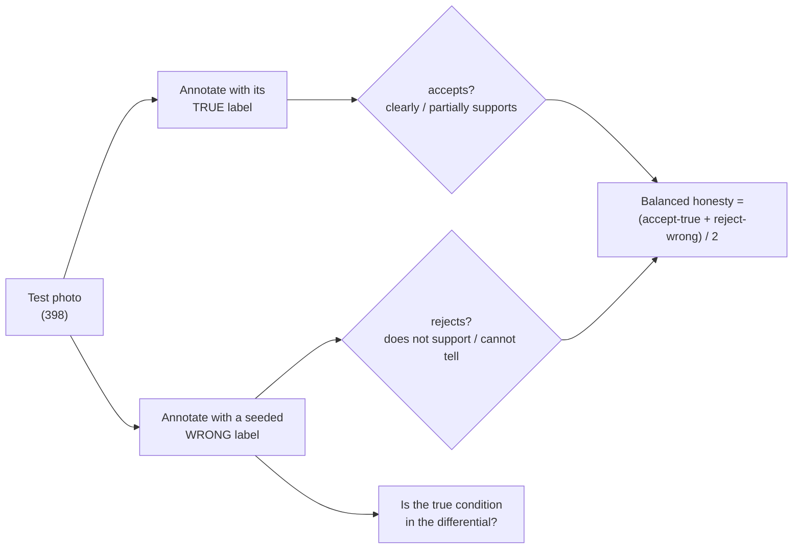

[← README](../README.md) · [Benchmark](BENCHMARK.md) · [Classifier](CLASSIFIER.md) · [Synthetic data](SYNTHETIC_DATA.md) · **VLM honesty** · [Captioning](CAPTIONING.md) · [Test-time compute](TEST_TIME_COMPUTE.md) · [Detector](DETECTOR.md) · [Compute](COMPUTE.md) · [Roadmap](ROADMAP.md)

# Explanations that can disagree with the label

**Problem.** In v1, MiniGPT-v2 receives the classifier's diagnosis *as ground truth* and writes a report around it.
When the classifier is wrong, a fluent explanation of the wrong disease is worse than no explanation. The end-to-end
v1 run also showed hallucinated details (for example "white powdery spores" on an overwatered plant).

**Goal.** An explainer that (a) describes only what is visible, (b) states when the photo does not support the
diagnosis it was given, and (c) names the likely alternative.

**Result.** An 8B student distilled from a 32B teacher's annotations, *filtered to the teacher's correct verdicts*,
is significantly more honest than its teacher (balanced 82.5 % vs 77.6 %, McNemar p = 0.00013) on a label-swap test.

## The annotation schema

[`cluster/vlm/annotation_spec.py`](../cluster/vlm/annotation_spec.py) defines one structured, label-conditioned annotation
per photo, enforced during decoding with vLLM structured outputs
([`cluster/vlm/annotate_vllm.py`](../cluster/vlm/annotate_vllm.py)):

| Field | Content |
|---|---|
| `image_quality` | real photo or not (illustration, collage, text overlay, screenshot), usability |
| `observations` | concrete visible findings, each with plant part and certainty |
| `missing_expected_signs` | signs the given label predicts that are **not** visible |
| `label_assessment.consistency` | `clearly_supports` / `partially_supports` / `does_not_support` / `cannot_tell` |
| `differential` | alternative conditions the photo is consistent with |
| `caption`, `report` | 2-4 factual sentences; a grower-facing report with one practical next check |
| `qa_pairs` | 4 grower questions, at least one about a sign that is *not* present |

Bounded arrays and strings plus a mild repetition penalty were necessary: under a JSON grammar, greedy decoding
otherwise loops (`"leaf", "leaf", …`) until the token limit (56/96 truncated outputs before the fix, 0/192 after).

## The label-swap honesty test

Every val and test photo is annotated twice: once told its true label, once told a seeded wrong label. An honest
annotator accepts the first and rejects the second; a sycophantic one accepts both. Chance is 50 %.
Scoring: [`cluster/vlm/score_honesty.py`](../cluster/vlm/score_honesty.py).

## Results (split v1 test, 398 photos × 2 labels = 796 verdicts)

<picture>
  <source media="(prefers-color-scheme: dark)" srcset="figures/honesty_dark.png">
  
</picture>

| Annotator | Accepts TRUE label | Rejects WRONG label | Balanced | True condition in differential (wrong label) |
|---|---|---|---|---|
| **8B student, from the classification-tuned 8B** | 318/398 = 79.9 % | 339/398 = 85.2 % | **82.5 %** | 389/398 = 97.7 % |
| Qwen3-VL-235B-A22B (AWQ), zero-shot | 340/396 = 85.9 % | 299/396 = 75.5 % | 80.7 % | 349/396 = 88.1 % |
| 8B student, from the base 8B | 315/397 = 79.3 % | 325/397 = 81.9 % | 80.6 % | 372/397 = 93.7 % |
| Qwen3.8-27B, zero-shot | 360/398 = 90.5 % | 270/398 = 67.8 % | 79.1 % | 299/398 = 75.1 % |
| Qwen3-VL-32B, zero-shot (teacher) | 313/398 = 78.6 % | 305/398 = 76.6 % | 77.6 % | 379/398 = 95.2 % |
| Qwen3-VL-8B, zero-shot | 288/398 = 72.4 % | 295/398 = 74.1 % | 73.2 % | 355/398 = 89.2 % |
| GLM-4.6V (FP8), zero-shot | 199/398 = 50.0 % | 311/398 = 78.1 % | 64.1 % | 312/398 = 78.4 % |

Paired McNemar on the 796 verdicts (only A right / only B right):

| Comparison | Discordant | p |
|---|---|---|
| student (cls-tuned) vs 32B teacher | 70 / 31 | **0.00013** |
| student (base) vs 32B teacher | 65 / 41 | 0.025 |
| student (cls-tuned) vs student (base) | 42 / 27 | 0.091 |
| 32B vs 8B, zero-shot | 88 / 53 | 0.004 |
| 27B vs 32B, zero-shot | 74 / 62 | 0.35 |
| student (cls-tuned) vs 27B | 92 / 65 | 0.038 |
| 235B vs 32B, zero-shot | 68 / 44 | **0.029** |
| student (cls-tuned) vs 235B | 62 / 47 | 0.18 |
| 32B vs GLM-4.6V, zero-shot | 182 / 74 | 1.1 × 10⁻¹¹ |

**Observations.**

- **Out of the box, VLMs go along with the label they are given** about a quarter of the time (32B rejects only
  76.6 % of wrong labels; the base 8B 74.1 %). For checking a diagnosis against a photo, the 32B is significantly
  more honest than the 8B, unlike plain classification where 32B = 8B.
- **Qwen3.8-27B is more agreeable, not more honest.** It accepts true labels more often (90.5 %) but also accepts
  wrong ones more often (rejects only 67.8 %) and rarely names the right alternative (75.1 % vs 95.2 % for the 32B).
  Higher general vision-benchmark scores did not translate into a better teacher for this task.
- **Qwen3-VL-235B is the most honest zero-shot model** (80.7 %, significantly above the 32B, p = 0.029), but its gain
  is in accepting true labels (85.9 vs 78.6 %), not in rejecting wrong ones (75.5 vs 76.6 %), and it names the right
  alternative less often (88.1 vs 95.2 %). It costs ~4× the GPU time of the 32B (five GPUs, 1 h 42 min for 796
  verdicts).
- **GLM-4.6V is over-cautious.** On true labels it answers "cannot tell" 144 times out of 398 (the Qwen models 1-2),
  so it accepts only half of them, and it still says "clearly supports" to 24 wrong labels (Qwen 4-5). Ruled out as a
  teacher, although it is the best zero-shot *diagnoser* of the five (75.6 %,
  [Test-time compute](TEST_TIME_COMPUTE.md#1-voting-over-sampled-diagnoses)): diagnosing a photo and judging a given
  label are different skills.
- **No zero-shot model is more honest than the filtered 8B student** (82.5 %).
- **Filtered distillation.** In the training data we know which given labels are wrong, so
  [`cluster/vlm/train_vlm_reports.py`](../cluster/vlm/train_vlm_reports.py) keeps only teacher annotations whose verdict is
  correct (accepts a true label / rejects a swapped one): 795 true-label + 302 wrong-label examples, LoRA r = 16,
  2 epochs. The student therefore never learns the teacher's ~23 % sycophantic verdicts. Starting from the
  classification-tuned 8B helps (trend, p = 0.091). The validation split gives the same ordering
  (79.2 / 77.0 / 77.3 / 71.4 %).

## Caveats

- **Re-verified after a hardware fault.** The student was first evaluated on a node whose local disk was later found
  to corrupt files ([Compute](COMPUTE.md)). Re-merged from its adapter and re-tested on a healthy node it scores
  83.2 % balanced (accepts 80.9 %, rejects 85.4 %; original run 82.5 %), with 25 of 796 verdicts different
  (p = 0.42) and the same margin over the teacher (72 / 28, p = 1.3 × 10⁻⁵).

- The students practised this label-checking format in training; the zero-shot models did not.
- The test measures **verdict honesty**, not the faithfulness of every sentence in the report. Claim-level
  faithfulness is measured separately with blind human ratings ([Captioning](CAPTIONING.md)).
- Labels are the dataset's labels; ~9 test-set labels are suspected wrong ([Benchmark](BENCHMARK.md#known-defects-of-the-data)),
  which slightly penalizes honest annotators.

## Does the order of the schema matter?

The schema writes observations *before* the verdict. Since explaining before answering costs zero-shot
classification 5-9 points ([Test-time compute](TEST_TIME_COMPUTE.md#3-explaining-before-answering-hurts)), the same
test was run with `label_assessment` (verdict first) moved to the front, everything else unchanged
(`annotate_vllm.py --order verdict-first`):

| Annotator | Order | Accepts TRUE label | Rejects WRONG label | Balanced | vs other order |
|---|---|---|---|---|---|
| Qwen3-VL-32B | observations first (default) | 78.6 % | **76.6 %** | 77.6 % | |
| Qwen3-VL-32B | verdict first | **92.5 %** | 65.3 % | 78.9 % | 62 / 52, p = 0.40 |
| Qwen3-VL-8B | observations first (default) | 72.4 % | 74.1 % | 73.2 % | |
| Qwen3-VL-8B | verdict first | 76.1 % | 76.1 % | 76.1 % | 79 / 56, p = 0.058 |

- **No general effect on balanced honesty** (32B +1.3 points, n.s.; 8B +2.9, borderline).
- **For the 32B the order moves the acceptance threshold, not the discrimination.** Writing observations first makes
  it markedly more sceptical: it goes along with a wrong label 23.4 % of the time instead of 34.7 %
  (wrong-label half 50 / 5, p = 2 × 10⁻¹⁰), at the cost of rejecting more true labels (true-label half 2 / 57,
  p = 6 × 10⁻¹⁵). The 8B shows no such shift.
- **For filtered distillation** the order trades yield: verdict-first produces more usable true-label examples,
  observations-first more examples of rejecting a wrong label. The default (observations first) is kept. Unlike
  zero-shot classification, describing first does not hurt the verification verdict.

## Next

The student is only as good as its teacher's verdicts and observations. Teacher candidates after this test: the
32B (current) or the 235B (more usable true-label examples, ~4× the cost); the 27B and GLM-4.6V are ruled out. The
plan is to regenerate the training annotations with the chosen teacher, filter claims with a verifier
([Captioning → filters](CAPTIONING.md#4-hallucination-filters)), retrain the student and re-run this test
([Roadmap](ROADMAP.md)). The schema-order question raised by the answer-format ablation is answered above: the order does not change
balanced honesty.
