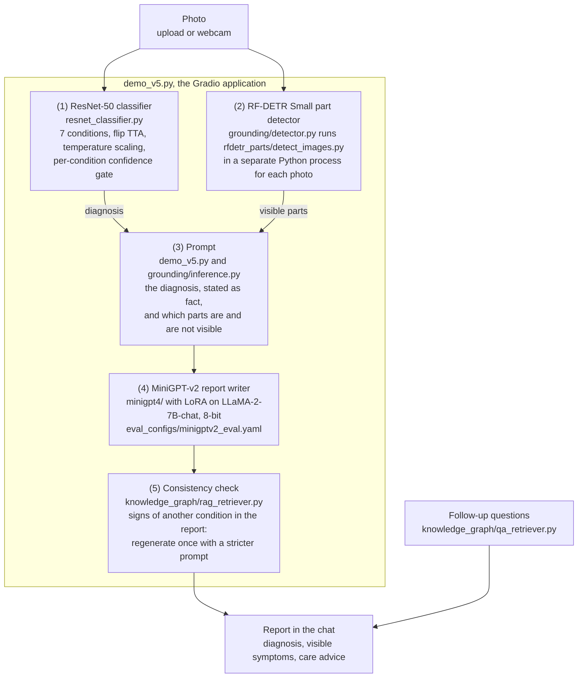
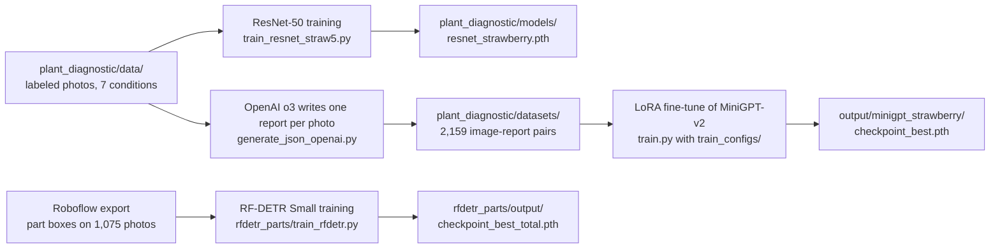

[← AGAI](../README.md) · [v2](../v2/README.md) · [Documentation](../docs/README.md) · [Lab notebook](../v2/EXPERIMENT_LOG.md)

# `v1/`: the original AGAI system (April 2026 technical report)

The system described in the April 2026 technical report ([RESEARCH_PAPER.pdf](RESEARCH_PAPER.pdf), sources in
[`paper/`](paper/)): a ResNet-50 classifier, an RF-DETR Small plant-part detector and a LoRA-adapted MiniGPT-v2
report writer behind a Gradio interface. This folder is the repository root as it was until 18 November 2026, moved
here unchanged, so the relative paths in the code and configs still work when `v1/` is the working directory. The
2026 revival's measurements of each component are in [`../docs/`](../docs/README.md); corrections found during the
revival are marked **Revival note**.

**v1 in the journal manuscript.** The 2026 journal manuscript is a different paper from the April report: it compares
this system with v2. Its v1 numbers are not taken from the April report; the revival re-measured v1 on the leak-free
split v1 with the code in [`../v2/`](../v2/README.md), as the baseline that v2 is compared against.

Where v1 appears in the journal manuscript (numbering of the 17 November 2026 build; full map with the code and
result files of every item: [`docs/PAPER_MAP.md`](../docs/PAPER_MAP.md)):

| v1 in the manuscript | Figures and tables |
|---|---|
| v1 results (the baseline) | Fig. 3 (leakage in v1's April 2026 evaluation); the v1 ResNet-50 rows of Fig. 4, Fig. 5b and Tables S4 and S5; Table S7 (v1 ResNet-50 calibration and gate); Table S9 (v1 RF-DETR Small); Table S16 (v1 report writer, detector on/off); Table S17 and Section 3.9 (v1 end to end) |
| how v1 works (no results) | Fig. 1, Figs. S1, S5, S6, S7 and S8; Tables S2 and S3 |

## How it works

The application chains three models and the knowledge base, all called from `demo_v5.py`:



Below the confidence gate's threshold the label becomes "unknown". How each model was trained:



1. **ResNet-50 classification.** A fine-tuned ResNet-50 classifies the image into one of seven conditions: healthy,
   drought, overwatering, root rot, frost injury, gray mold, or white mold. Test-time augmentation and temperature
   scaling produce calibrated confidence scores.
2. **RF-DETR part detection.** An RF-DETR Small object detector identifies which plant parts are visible (flower,
   fruit, leaf, root, soil, stem). Per-class confidence thresholds are tuned to each part's detection
   characteristics. The detected parts are meant to constrain MiniGPT's output to what is visible; the detector
   on/off ablation of 2026-10-31 found that the writer does not follow the constraint (see
   [DETECTOR.md](../docs/DETECTOR.md), Caveats). The application runs the detector in a separate interpreter per
   photograph (`grounding/detector.py`), which cost 15.9 s of v1's 62 s median per photograph on an RTX 5000 Ada
   (lab notebook, 2026-10-31); the forward pass itself takes 0.016 s.
3. **MiniGPT-v2 grounded explanation.** A LoRA-adapted MiniGPT-v2 (LLaMA-2-7B backbone) receives the ResNet diagnosis
   as ground truth and the RF-DETR part detections as visibility constraints. It generates a structured diagnostic
   report covering the diagnosis, visible symptoms on detected parts, and treatment recommendations. Parts that are
   not detected are listed in the prompt as not visible; in the ablation this did not reduce part hallucination
   (86.1 % of reports without the lists, 92.1 % with them, on 151 split v1 test photographs). Loaded in 8-bit as
   the application does, the writer produced a report in 46 s median on an RTX 5000 Ada (337 tokens at 7.3 tokens
   per second; lab notebook, 2026-10-31).

The knowledge base answers follow-up questions, draws the knowledge-graph tab and checks each report for symptoms of
other conditions. It also holds part-specific treatments keyed to RF-DETR's parts, but the application never adds them,
or any other knowledge-base text, to a report: nothing calls `DiseaseRAG.get_part_specific_treatments()` or
`get_context()` (checked on 18 November 2026).

> **Revival note.** Because the explainer treats the classifier's label as ground truth, a wrong label produces a
> fluent explanation of the wrong disease. The revival measures this directly with a label-swap test and trains an
> explainer that can disagree with its input label ([VLM honesty](../docs/VLM_HONESTY.md)).

## What is in this folder

| Path | Contents |
|---|---|
| [`demo_v5.py`](demo_v5.py), [`ui_components.py`](ui_components.py), [`dark_theme.css`](dark_theme.css) | the Gradio application (entry point `demo_v5.py`) |
| [`resnet_classifier.py`](resnet_classifier.py) | ResNet-50 inference: flip test-time augmentation, temperature scaling, acceptance gate |
| [`train.py`](train.py) | MiniGPT-v2 training entry point (configs in [`train_configs/`](train_configs/)) |
| [`eval_only.py`](eval_only.py), [`eval_holdout.py`](eval_holdout.py), [`test_grounding.py`](test_grounding.py) | MiniGPT evaluation, a holdout evaluator that does not run, and the end-to-end grounding script |
| [`environment.yml`](environment.yml) | Conda specification inherited from upstream MiniGPT-4 (see Setup for the versions that work) |
| [`minigpt4/`](minigpt4/) | MiniGPT-v2 framework: upstream MiniGPT-4 code with the lab's changes |
| [`configs/`](configs/), [`eval_configs/`](eval_configs/), [`train_configs/`](train_configs/) | MiniGPT model, inference and training configs |
| [`grounding/`](grounding/) | runs the part detector and prompts MiniGPT-v2 for the application |
| [`rfdetr_parts/`](rfdetr_parts/) | RF-DETR Small training, threshold tuning and inference |
| [`knowledge_graph/`](knowledge_graph/) | disease knowledge base and the retrievers used by the application |
| [`hallucination_evaluation/`](hallucination_evaluation/) | 2025 checks of report quality against known disease indicators |
| [`plant_diagnostic/`](plant_diagnostic/) | labeled photographs, classifier training code, report-writer instruction data |
| [`evaluation/`](evaluation/) | the April 2026 holdout evaluations and an older evaluator |
| [`paper/`](paper/), [`RESEARCH_PAPER.pdf`](RESEARCH_PAPER.pdf), [`RESEARCH_PAPER.tex`](RESEARCH_PAPER.tex) | the April 2026 technical report: sources, scripts, build (`RESEARCH_PAPER.pdf` is a copy of `paper/main.pdf`) |
| [`tests/`](tests/) | unit tests from October 2025 |
| [`llama_weights/`](llama_weights/) | where the LLaMA-2-7B-chat weights go (not in the repository) |
| [`recovered/`](recovered/) | code recovered from the lab server's working copy (19 October 2026), byte for byte |
| [`figs/`](figs/), [`documentation/`](documentation/), [`annotationjsons/`](annotationjsons/) | older figures and session notes, one detector annotation export |

Each folder has its own README.

## Paths

- **Working directory.** Run everything from `v1/` (`cd v1`), as the commands below do. The code finds configs,
  `minigpt4/`, `grounding/`, `knowledge_graph/` and the model folders relative to it.
- **Lab-server paths.** Many configs and scripts name files by absolute paths on the lab's original server,
  `/data/AGAI/MiniGPT-4/...` (the folder that is now `v1/`): `eval_configs/`, `train_configs/`, `configs/`,
  `grounding/config.py`, `rfdetr_parts/`, `tests/`, and MiniGPT's own config lookup in `minigpt4/common/utils.py`. On
  another machine, replace that prefix with the location of this folder, or link `/data/AGAI/MiniGPT-4` to it. The
  cluster copy used in 2026 had the prefix replaced in about 60 files.
- **The v2 code uses this folder.** The revival's scripts open the photographs in `plant_diagnostic/data/` (through the
  paths stored in [`../evaluation/split_v1.json`](../evaluation/split_v1.json)), import `resnet_classifier.py`,
  `grounding/` and `knowledge_graph/`, and retrain the report writer with `train.py`. They run in a working folder that
  puts this tree, `evaluation/` and the v2 scripts side by side; see [`../v2/README.md`](../v2/README.md).

> **Revival note.** A few files here were changed during the 2026 revival, and the v2 results depend on those
> versions: `demo_v5.py` and `knowledge_graph/rag_retriever.py` (31 October 2026, a negation-aware consistency check
> with 16 hallmark phrases), `grounding/detector.py` (the `RFDETR_PYTHON` interpreter override),
> `minigpt4/models/minigpt_base.py` (passes `reduction` to the LLaMA forward only when it is not `"mean"`),
> `minigpt4/processors/blip_processors.py` (an `identity_text` processor, which the split v1 retrain uses) and
> `minigpt4/tasks/image_text_pretrain.py` (a validation-loss step, which the runner never calls while training; the
> retrain's checkpoint was chosen afterwards with `v2/vlm/minigpt_val_loss.py`), and the new
> `train_configs/minigptv2_strawberry_splitv1.yaml`. The application as deployed on the lab server in
> April 2026 is therefore not exactly the code here. That server's working copy also had changes that were never
> committed: 16 files, recovered byte for byte into [`recovered/`](recovered/), and a Gradio 4 fix to `demo_v5.py`
> ([`recovered/labbox_2026-10-19/README.md`](recovered/labbox_2026-10-19/README.md)).

## Features

- **Three-stage AI pipeline** with classification, detection, and vision-language explanation
- **Seven disease classes**: healthy, drought, overwatering, root rot, frost injury, gray mold, white mold
- **Plant-part grounding**: RF-DETR constrains MiniGPT to only describe visible parts, with optional bounding box
  overlay on the uploaded image
- **Knowledge graph**: disease-specific follow-up Q&A grounded in university extension publications (the
  part-specific treatments it holds are not used by the application)
- **Hallucination detection**: cross-checks model output against known disease indicators to flag and regenerate
  confused responses
- **Web search integration**: optional SERP API enrichment for supplementary context
- **Dark-themed Gradio interface** with chat, settings, and an interactive disease knowledge graph visualization

## Requirements

- Python 3.9+ (the demo runs in a `minigptv` Conda environment; RF-DETR training uses a separate `rfdetr` environment
  with Python 3.11)
- CUDA GPU with 16 GB+ VRAM (RTX 3090 or better recommended; the lab's original server, where v1 was trained and
  served, had two RTX 3090 with 24 GB each)
- PyTorch with CUDA support
- Model weights (not included in the repository), at these paths relative to this folder (the configs spell them
  out under `/data/AGAI/MiniGPT-4/`; see [Paths](#paths)):
  - LLaMA-2-7B-chat: `llama_weights/Llama-2-7b-chat-hf/`
  - MiniGPT-v2 fine-tuned checkpoint: `output/minigpt_strawberry/checkpoint_best.pth`
  - ResNet-50 classifier: `plant_diagnostic/models/resnet_strawberry.pth`
  - RF-DETR Small fine-tuned checkpoint: `rfdetr_parts/output/checkpoint_best_total.pth`
- (Optional) a SERP API key for web search features

> **Revival note.** On the lab machine the runtime default `resnet_strawberry.pth` is a post-paper checkpoint
> (v12, trained with synthetic images), not the paper's v4. The paper's v4 weights match the SHA-256 in the paper's
> appendix and were used for the reproduction ([Classifier](../docs/CLASSIFIER.md)).

## Setup

```bash
# Clone the repository and work in this folder
git clone https://github.com/greatroboticslab/AGAI.git
cd AGAI/v1

# Create the Conda environment for the demo
conda env create -f environment.yml
conda activate minigptv

# Install PyTorch with CUDA support (adjust cu121 to match your driver)
pip install torch torchvision torchaudio --index-url https://download.pytorch.org/whl/cu121

# Install remaining dependencies (transformers 4.45.2 and gradio 3.47.1: see the revival notes below)
pip install transformers==4.45.2 gradio==3.47.1 bitsandbytes pillow numpy pandas plotly networkx python-dotenv timm serpapi
```

> **Revival note.** The original instructions pinned `transformers==4.41.1`. With 4.41 the `cache_position` shim in
> `grounding/inference.py` hides the model's forward signature, so `generate()` builds no attention mask and re-feeds
> every generated token: the KV cache grows quadratically, generation runs out of memory on a 32 GB GPU and the text
> becomes repetitive. 4.45.2 works ([Compute](../docs/COMPUTE.md#software-environments)). `environment.yml` itself
> pins `transformers==4.30.0`.

> **Revival note.** `demo_v5.py` creates its upload widget with Gradio 3's `gr.Image(source=...)`, which Gradio 4
> rejects; keep the `gradio==3.47.1` of `environment.yml`. The lab server's copy had a Gradio 4 fix
> (`sources=["upload"]`), described in [`recovered/labbox_2026-10-19/README.md`](recovered/labbox_2026-10-19/README.md).

For RF-DETR training, a separate environment is needed:

```bash
conda create -n rfdetr python=3.11 -y
conda activate rfdetr
pip install rfdetr torch torchvision --index-url https://download.pytorch.org/whl/cu121
```

### Environment variables

```bash
export PYTORCH_CUDA_ALLOC_CONF=expandable_segments:True
export SERP_API_KEY=your_key_here   # optional, for web search features
export RFDETR_PYTHON=/path/to/rfdetr/env/bin/python   # optional: interpreter for the detector subprocess
```

`demo_v5.py` reads `SERP_API_KEY` from the environment; it does not load a `.env` file.

## Running the demo

```bash
cd v1
python demo_v5.py      # --cfg-path defaults to eval_configs/minigptv2_eval.yaml
```

This starts a Gradio web interface (`demo.launch(share=True)`, so Gradio also prints a public share link). Open the
printed URL in your browser, upload a strawberry plant image, and the system will return a structured diagnosis. Use
the settings panel to toggle bounding box visualization, adjust generation temperature, or explore the knowledge graph
tab.

## Training

All commands run from `v1/`.

| Model | Command | Notes |
|---|---|---|
| Report writer (MiniGPT-v2 with LoRA) | `python -m torch.distributed.run --nproc_per_node=2 train.py --cfg-path train_configs/minigptv2_strawberry.yaml` | the lab's recipe with lab-server paths. `minigptv2_strawberry_v2.yaml` is the same file with `evaluate: true`, which makes `train.py` evaluate only (its `_v2` names the recipe, not the revival). The revival's retrain on split v1 uses `train_configs/minigptv2_strawberry_splitv1.yaml` through [`../v2/slurm/train_minigpt_splitv1.sbatch`](../v2/slurm/train_minigpt_splitv1.sbatch) |
| Condition classifier (ResNet-50) | `python recovered/labbox_2026-10-19/plant_diagnostic/scripts/resnetscripts/train_resnet_straw5.py --train_root <train> --val_root <val> --out <checkpoint.pth> --seed 42` | the version that trained every ResNet-50 of the 2026 manuscript (split v1 runs, ablations, 512-pixel control): images resized to 256 × 256 without cropping, no random erasing. The script of the same name at `plant_diagnostic/scripts/resnetscripts/` is the older 2025 version (random crop, random erasing, centre-crop validation) |
| Part detector (RF-DETR Small) | `python rfdetr_parts/prepare_dataset.py --zip <Roboflow export> --out rfdetr_parts/dataset`, then `python rfdetr_parts/train_rfdetr.py` (in the `rfdetr` environment) | settings in `rfdetr_parts/rfdetr_config.yaml`; the trained checkpoint is saved to `rfdetr_parts/output/` |

The two-GPU launch the lab used for the report writer:

```bash
CUDA_VISIBLE_DEVICES=0,1 MASTER_PORT=29607 PYTORCH_CUDA_ALLOC_CONF=expandable_segments:True \
  python -m torch.distributed.run --nproc_per_node=2 train.py \
  --cfg-path train_configs/minigptv2_strawberry.yaml
```

### Instruction data (image-report pairs)

The 2159 reports that trained the v1 report writer were written by OpenAI's o3 through
[`generate_json_openai.py`](plant_diagnostic/scripts/gptscripts/json_generation/generate_json_openai.py). For each
image it sends the photograph and its label, which is the name of the class folder, with a prompt that fixes the label
and limits the report to what is visible, and it writes one image-report pair per line. An interrupted run resumes
where it stopped. When a call fails it writes a templated fallback report; none of the 2159 is a fallback. The empty
`generate_stage2_jsonl.py` beside it is a placeholder from 2025.

```bash
export OPENAI_API_KEY=...   # in the environment only, never in a file of this repository
python plant_diagnostic/scripts/gptscripts/json_generation/generate_json_openai.py \
    --img-root plant_diagnostic/data/train_aug \
    --out plant_diagnostic/datasets/stage2_train_7class.jsonl --model o3 --sleep 0.6
python plant_diagnostic/scripts/convert_jsonl_to_json.py \
    plant_diagnostic/datasets/stage2_train_7class.jsonl plant_diagnostic/datasets/stage2_train_7class_fixed.json
```

A later generator from the lab server, `generate_multicaption_jsonl.py`, writes several conversation styles per image
(clinical, quick triage, treatment, differential, severity, layperson). It is in [`recovered/`](recovered/), and no
reported result uses it.

### Code recovered from the lab server

[`recovered/labbox_2026-10-19/`](recovered/labbox_2026-10-19/) holds, byte for byte, the 16 code files that existed only
in the lab server's working copy when it was exported on 19 October 2026: the April 2026 versions of the ResNet-50
training, evaluation and inference scripts, the scripts that rebuilt the training and holdout sets with synthetic and
external images for the lab's late-April checkpoints, two evaluation scripts for those checkpoints, the April
technical report's MiniGPT holdout scripts and the multi-caption generator. The cluster runs for the 2026 manuscript
used a copy of that working copy, so the recovered `train_resnet_straw5.py` is the script behind the manuscript's
ResNet-50 results; the older same-named scripts at the main paths are left as they are. That folder's README gives the
provenance, checksums and how to run each file.

## Knowledge graph and RAG

The `knowledge_graph/disease_knowledge_base.json` file contains detailed, citation-backed information for all seven
disease classes, including:

- Symptoms, causes, visual indicators, and severity ratings
- Treatment protocols compiled from UC IPM, Penn State Extension, NC State Extension, Cornell
  Extension, University of Minnesota Extension, and others
- **Part-specific treatments** keyed to RF-DETR detections (e.g., fruit-specific advice for gray mold when fruit is
  detected in the image)
- Recovery timelines and prevention strategies

In the application, `DiseaseRAG` supplies the knowledge-graph view and the hallucination check (its context and
part-specific treatment methods are not called), while `DiseaseQA` handles follow-up
questions with pattern-matched routing to the appropriate knowledge section.

## Architecture diagrams (outdated)

### Inference dataflow


### End-to-end inference sequence


### Training pipeline


## Demo videos (outdated)

### Project overview
[](https://youtu.be/-QEf8KkALK4?si=mVatePAGOcpFYOXw)

### Current demo (demo_v5)
[](https://youtu.be/eduSbkigjLY?si=24JHh-qNNbvROLdD)

### Webcam and unknown scenario
[](https://youtu.be/PXN6_6oj7_M)
