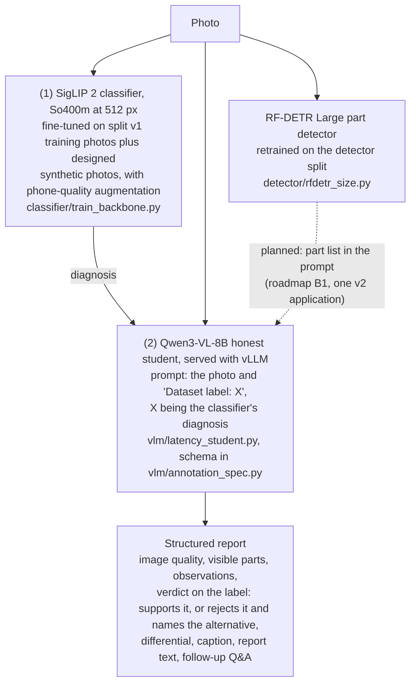
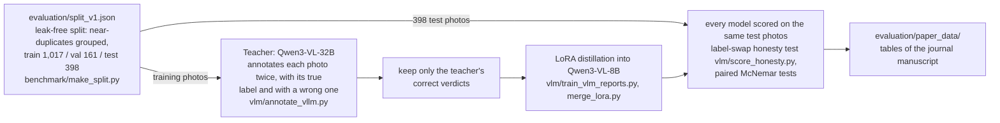

[← AGAI](../README.md) · [v1](../v1/README.md) · [Documentation](../docs/README.md) · [Lab notebook](EXPERIMENT_LOG.md)

# `v2/`: the 2026 revival (code and lab notebook)

From October 2026 the lab re-established AGAI on MTSU's Hamilton cluster and re-examined every component under a
stricter protocol: the v1 results were reproduced first, then a component was replaced only where a leak-free,
seed-replicated, paired comparison showed a gain. This folder holds the code behind every number in the
[documentation](../docs/README.md) and the lab notebook [`EXPERIMENT_LOG.md`](EXPERIMENT_LOG.md), which records each
run (job ID, arguments, result file, conclusion), every pre-registration and every correction.

**The journal manuscript is built on this folder.** Every number in the 2026 journal manuscript (its LaTeX is on
Overleaf) was produced by the code here, on the leak-free split v1, and its result files are in
[`../evaluation/paper_data/`](../evaluation/paper_data/README.md). The manuscript compares the v2 system with v1, which
the same code re-measured on the same split as the baseline; none of its numbers come from the April 2026 report.
The answers to its open notes, with the evidence, are in [`../docs/MANUSCRIPT_QA.md`](../docs/MANUSCRIPT_QA.md).

Where v2 appears in the manuscript (numbering of the 17 November 2026 build; full map with the code and result files
of every item: [`docs/PAPER_MAP.md`](../docs/PAPER_MAP.md)):

| v2 in the manuscript | Figures and tables | Code |
|---|---|---|
| the leak-free benchmark | Fig. 3d | [`benchmark/`](benchmark/) |
| the classifier (SigLIP 2 chosen) | Fig. 4, Fig. S9; Tables S4, S5, S6, S7 | [`classifier/`](classifier/) |
| synthetic data and robustness | Fig. 5; Table S8 | [`synthetic/`](synthetic/), [`classifier/`](classifier/) |
| the part detector (RF-DETR Large) | Table S9 | [`detector/`](detector/) |
| explanations that can reject a wrong diagnosis (the student) | Fig. 6; Table S10 | [`vlm/`](vlm/) |
| captioning and hallucination filters | Fig. 7; Tables S11, S12 | [`vlm/`](vlm/) |
| test-time compute | Tables S13, S14, S15 | [`vlm/`](vlm/) |
| v2 against v1, end to end | Table S17 and Section 3.9 (accuracy, honesty, latency, memory, claim faithfulness), abstract, conclusion | [`vlm/`](vlm/), [`classifier/`](classifier/), [`detector/`](detector/), [`slurm/`](slurm/) |

The v1 numbers beside them (the baseline) were measured with the same code; see the v1 rows of the map.

The v2 components chosen so far are a SigLIP 2 classifier, an RF-DETR Large part detector and a Qwen3-VL-8B report
writer (the "honest student") that can reject the classifier's diagnosis and name an alternative. There is no single v2
application yet (item B1 of the [roadmap](../docs/ROADMAP.md)); the end-to-end v2 runs so far are the latency and
claim-faithfulness comparison with v1 (`vlm/latency_*.py`, `vlm/score_faithfulness.py`).

## How v2 works

The v2 system as it was measured end to end (latency and claim faithfulness, 49 split v1 test photographs):



Unlike v1's writer, the student is not told that the diagnosis is right: it judges the proposed label against the
photo, and it lists the visible parts itself. RF-DETR Large was retrained and measured (accuracy and speed), but its
detections are not yet passed to the student.

How the student was made, and how every model, v1 and v2, was scored:



## Folders

| Folder | Contents | Results |
|---|---|---|
| [`benchmark/`](benchmark/) | the leak-free split v1, leakage and label audits, v1 baselines, leaderboards and paired tests | [Benchmark](../docs/BENCHMARK.md) |
| [`classifier/`](classifier/) | backbone probes and fine-tunes (including the SigLIP 2 classifier), cross-validation, ensembles, robustness, calibration and acceptance gates, latency | [Classifier](../docs/CLASSIFIER.md) |
| [`synthetic/`](synthetic/) | synthetic-image import, training trees, one synthetic-data arm end to end | [Synthetic data](../docs/SYNTHETIC_DATA.md) |
| [`vlm/`](vlm/) | annotation schema, label-swap honesty, the honest student, captioning, claim judges, voting, disagreement resolution; the v1 report writer's split v1 retrain and its scoring (Table S16); v1 vs v2 latency and claim faithfulness | [VLM honesty](../docs/VLM_HONESTY.md), [Captioning](../docs/CAPTIONING.md), [Test-time compute](../docs/TEST_TIME_COMPUTE.md) |
| [`detector/`](detector/) | RF-DETR Small, Medium and Large: evaluation, training, the detector split, per-part metrics, latency | [Detector](../docs/DETECTOR.md) |
| [`infra/`](infra/) | cluster setup, environment variables, model staging and verification, multi-node helpers, environment freezes, `make_workdir.sh` | [Compute](../docs/COMPUTE.md) |
| [`slurm/`](slurm/) | Slurm job scripts: multi-node vLLM and LoRA, the honest student, synthetic arms, the manuscript runs | [Compute](../docs/COMPUTE.md) |

Each folder's README lists every script with its environment, inputs, outputs and an example.

## Running the scripts

The scripts were written for, and run in, one working copy on the cluster (`/projects/$USER/agai/MiniGPT-4`): the v1
tree with `evaluation/` inside it and these scripts in `cluster/`. They open `evaluation/split_v1.json`, the
photographs it lists (`plant_diagnostic/data/...`, which is in [`../v1/`](../v1/)), v1 modules
(`resnet_classifier.py`, `grounding/`, `knowledge_graph/`) and v1 configs relative to the working directory.
[`infra/make_workdir.sh`](infra/make_workdir.sh) rebuilds such a folder out of symbolic links into this repository:

```bash
bash v2/infra/make_workdir.sh /projects/$USER/agai-work
source /projects/$USER/agai/agai_env.sh    # cluster variables (a copy of infra/agai_env.sh); it ends with a cd
cd /projects/$USER/agai-work
python cluster/vlm/score_faithfulness.py --help    # the paths used in these READMEs
python cluster/score_faithfulness.py --help        # the flat paths used in the lab notebook
```

In that folder `v2/` appears as `cluster/`, both by study (`cluster/vlm/...`) and flat (`cluster/<script>`), so the
commands in the notebook, in [`../docs/`](../docs/README.md) and in the Slurm files work as written there.

Slurm jobs need one more step. Every job sources the copy of `agai_env.sh`, which ends with
`cd /projects/$USER/agai/MiniGPT-4`, and six job files `cd` there again, so a job runs in that folder whatever folder it
was submitted from. To run jobs against a folder built by `make_workdir.sh`, build it at that path or change those `cd`
lines; [`slurm/README.md`](slurm/README.md) lists the files. Checked on
Hamilton on 18 November 2026: from the committed files, `vlm/make_faithfulness_claims.py --check`,
`vlm/score_faithfulness.py` (primary and all-ratings analyses) and `vlm/score_reports.py` (Table S16) reproduce the
committed results byte for byte, and the v1 modules import as they did from the old repository root.

Conventions on the cluster: Python environments are plain venvs in `/projects/$USER/agai/envs/` (`minigptv` for v1
code, `rfdetr`, `vision`, `vllm`, `vlm`); models live under `/projects/$USER/agai/models` and are staged to node-local
NVMe; Slurm logs go to `/projects/$USER/agai/logs/<job-name>-<jobid>.out`; hardware and environments are described in
[Compute](../docs/COMPUTE.md). Most scripts write per-image results to `evaluation/<name>.json`; those stay in the
working folder, and the copies the manuscript needs were moved by hand into
[`../evaluation/paper_data/`](../evaluation/paper_data/). Starting from the committed files therefore sometimes needs
a `paper_data/` path in place of a default; the study READMEs say where.

Example, the 235B claim judge across five nodes (submitted from, and run in, `/projects/$USER/agai/MiniGPT-4`):

```bash
sbatch -N 5 --export=ALL,VLLM_SCRIPT=cluster/vlm/judge_claims.py cluster/slurm/vllm_ray.sbatch \
    Qwen3-VL-235B-A22B-Instruct-AWQ 16,20,20,19,19 --modes zoom --max-model-len 8192 --gpu-mem 0.95 --enforce-eager
```

## The lab notebook

[`EXPERIMENT_LOG.md`](EXPERIMENT_LOG.md) is append-only: entries are dated, and corrections are new entries rather than
edits. Its commands use the flat names of the cluster working copy (`cluster/<script>`), which exist in the folder built
by `make_workdir.sh`. Copies of the notebook on the cluster (`cluster/` and `evaluation/` of the working copy) are kept
identical, except that this public copy replaces a private rating-page link with a placeholder and adds a note on the
public release.

## What v2 takes from v1 and from `evaluation/`

- **Photographs.** The benchmark files list images as `plant_diagnostic/data/...`, relative to [`../v1/`](../v1/). The
  repository's copy of the photographs is older than the lab server's, so some listed paths are not in it (see
  [`../evaluation/README.md`](../evaluation/README.md)).
- **v1 code run by v2 studies.** `resnet_classifier.py` (ResNet-50 baselines, calibration, latency), `grounding/` and
  `knowledge_graph/rag_retriever.py` (v1 reports, latency), `train.py` with
  `train_configs/minigptv2_strawberry_splitv1.yaml` (the report writer's split v1 retrain), and `rfdetr_parts/` (config,
  dataset and checkpoint of the v1 detector).
- **Benchmark and result files.** [`../evaluation/`](../evaluation/README.md): `split_v1.json`, `bakeoff_set_v1.json`,
  `label_audit.csv` and `paper_data/`; the v1 holdout evaluations in [`../v1/evaluation/holdout/`](../v1/evaluation/holdout/).

## Not published here

One-off diagnostics, superseded annotators and the per-experiment Slurm wrappers (each stages a model and runs one of
the scripts in these folders). Their runs are recorded in the notebook.
